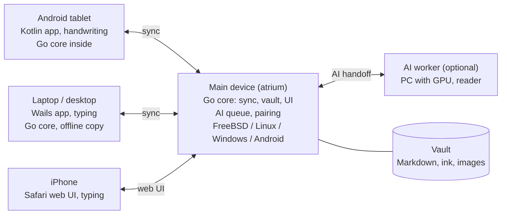

# Styli — Design Doc

Exported Nov 24, 2026 from the living design doc: https://claude.ai/artifact/KZfPcAKEbztkJcLTiwzmRb

## Overview

A self-hosted notes app: handwrite on a tablet or type on any device, sync across your own trusted devices, and let a local AI turn handwriting and diagrams into plain Markdown that it files and links by topic.

Core goals:

- Handwriting that feels like GoodNotes or Samsung Notes on an Android tablet.
- Typed notes from iPhone, laptop and desktop.
- Sync between trusted devices only, with one device chosen as the main atrium. No third-party cloud.
- A local AI that converts handwriting and diagrams to text and organizes notes into topics, with the Nexus, an Obsidian-style graph of the links.
- Portable output: standard Markdown files any editor can open.

The name is Styli (the Roman writing tool, and the plural of stylus). Visual identity: style A (ancient meets modern: Marcellus headings, Inter body, bone and ink neutrals) with beeswax amber (#C8902E) as the accent. Logo (for now): a tilted wax tablet with glossy honey wax and an aged bone stylus, no tile. See the [identity explorations](https://claude.ai/artifact/8R57m9N22P5fNPKnGsob9J), the [Styli design system](https://claude.ai/artifact/CbHziiUDvVrqqKMGVKJ344) (tokens in `design/tokens.json`) and the [screen mockups](https://claude.ai/artifact/DdEZz7DPrtKNAR97AQFGRF).

## Architecture

One Go core runs everywhere. On the atrium it holds the full vault, serves the web UI and runs the AI queue; on other devices it's embedded in the app and syncs with the atrium.

- **Android tablet:** Kotlin app for handwriting, with the Go core embedded through gomobile.
- **Laptop and desktop:** Wails app (the web UI in a native window), with its own Go core and synced copy, so it works offline.
- **iPhone:** the atrium's web UI in Safari, added to the Home Screen. Typing-focused and needs a connection to the atrium.
- **Atrium:** the Go core running as a background service, with no screen needed.

## Notes and file format

Every note is a standard Markdown (`.md`) file in a plain folder vault, readable by any text editor. Nothing Obsidian-specific.

- **Text:** CommonMark Markdown. Headings, lists, emphasis, LaTeX for math.
- **Diagrams:** each converted diagram can carry a Mermaid code block, the original sketch as an image, or both. A global default sets which ones are kept, and each note can override it.
- **Pages:** a converted handwritten document keeps its page breaks. Each page starts with an HTML comment, `<!-- styli:page 2 portrait -->` (page number, then `portrait` or `landscape`). It is valid CommonMark and invisible in other editors; the app splits on it to show one page at a time. One Markdown file per document, however many pages.
- **Tags:** one HTML comment per note, `<!-- styli:tags networking, tcp, handshake -->`. Valid CommonMark and invisible in other editors, like the page marker. The AI writes it when it analyses a note, and the user can edit it by hand. Because the tags live in the file they sync with the note and survive an index rebuild.
- **Links:** standard relative Markdown links, for example `[TCP handshake](../Networking/TCP%20Handshake.md)`. The Nexus (the graph view) is built from these.
- **Vault:** topic folders of `.md` files, with images and attachments stored alongside.
- **Handwriting source:** the tablet stores ink as vector strokes (points, pressure, timestamps). The ink is the source of truth for handwritten notes; the Markdown is generated from it.

## Sync and storage

Sync is our own, written in Go, and offline-first: any device can edit while disconnected and changes merge when it reconnects. No Syncthing, no Bluetooth. Transport is Wi-Fi/LAN at home and a VPN (WireGuard or Tailscale) when away.

Each note has one of three storage states per device:

| State | On the device | Works offline |
| --- | --- | --- |
| Kept offline | Full copy, always current | Yes, read and edit |
| Cached | Copy of a recently opened note, cleared automatically when space is needed | Until cleared |
| Online-only | Name and folder only; fetched from the atrium on open | No |

Rules:

- **Default:** text syncs everywhere; handwriting strokes and images are online-only. "Everything online-only" is an option for low-storage devices.
- **Defaults are chosen by the user during device setup**, with per-folder or per-notebook overrides.
- **Editing an online-only note** pulls it into the cache, saves locally, then syncs. It feels like editing on the server, but nothing is lost if the connection drops.
- **Clearing a local copy** is allowed only when the atrium confirms it has that exact version. Notes with unsynced changes are never cleared.
- **The atrium holds the only complete copy**, so the atrium's vault must be included in its backups.
- **Backups are the user's job for now.** Styli does not manage backups yet: backing up and restoring the vault folder (which holds `.ids/` with the note IDs, history and trash, plus ink data and attached files) is a documented operational requirement, and the dashboard shows the backup reminder. Backup management inside Styli is planned for a later phase (see the list for the future).

## Devices and pairing

Any FreeBSD, Linux, Windows or Android device can be the main device (atrium) from the start. iOS and macOS atriums come later.

Android as the atrium needs three things:

- A foreground service with a permanent notification, so Android doesn't kill it.
- Atrium discovery, because a phone's address changes: automatic discovery on the local network, plus the VPN when away.
- AI handoff, since a phone can't run a capable reader. Pages queue until a worker machine is available.

A new device joins in two steps:

1. **Magic words.** The atrium shows a short random phrase (for example `amphora-legion-stylus-fig`, from Styli's Roman word list). The new device types it in. A PAKE (password-authenticated key exchange) means an attacker gets one guess, so four words are enough.
2. **Emoji handshake.** Both screens show the same emoji row; the user confirms they match on both devices.

After pairing, each device holds its own key. A settings page lists all devices, and any one can be revoked, and restored later from the atrium. All traffic between devices is encrypted.

How pairing is built (phase 2):

- **The words and emoji lean on ancient Rome.** The magic words come from a list of 338 Roman-flavoured words (`amphora`, `legion`, `stylus`…). Four words give about 1 in 13 billion odds for the one guess an attacker gets. The emoji row is 6 symbols from 64 (amphora, eagle, wolf, olive, trident…), each with a name for screen readers and reading aloud. These lists are the app's theme and are fixed; there are no user-chosen lists (decided 2026-11-25).
- **The PAKE is CPace,** from `filippo.io/cpace`, pinned to its one published version. No Go PAKE library has had a published audit; this one was chosen because its author led Go's cryptography libraries and it is small enough to read in full. The pairing code is part of the security review before real use. The exchange is bound to both devices' keys and to the exact TLS connection, and each side then proves it got the same key. Wrong words, or anyone relaying the connection in the middle, fail that proof, and the words are used up after one try either way.
- **The emoji are worked out from the TLS connection and both keys, not from the PAKE,** so a flaw in one check is still caught by the other.
- **One pairing at a time.** Opening a new one ends the last. The words work for 5 minutes, and the emoji wait another 5 minutes to be compared. Nothing is saved until the person approves on both devices.
- **Unknown keys and the sync port.** While words are waiting, the sync port lets a key that is not paired through the TLS handshake, but only as far as the pairing endpoints. Outside a pairing, unknown keys are refused at the handshake.
- **A key the atrium already knows** (paired, or revoked) is refused before the words are tried, so the words are not used up. A revoked device makes a new key: its old key file is moved aside, never deleted.
- **The device side is `styli join --vault DIR [--atrium HOST]`.** Without `--atrium` it looks for an atrium on the network (3 seconds): exactly one found is used, none or several stop with a message (several are listed, to choose with `--atrium`). `--atrium` can be given more than once (a home name, a VPN name): the first that answers is used for pairing and all are kept for later. It checks that the typed words are four words from the list before sending them, so a typo does not use up the try. The device saves the atrium's key and address in its own settings; the Settings form can never overwrite them, only pairing can.
- **The atrium side is the Devices card on the Settings screen:** the words, then the emoji with "They match" and "They don't match".

## AI pipeline

The AI runs on the main device by default and can hand work off to another machine, such as a PC with a GPU. Handoff is required when the atrium is an Android device.

1. A handwritten page syncs to the atrium.
2. The atrium queues it, then renders it and sends it to the user's reader (a local vision model) through an OpenAI-compatible API (llama.cpp, Ollama or LM Studio), on the atrium or on a worker.
3. The reader returns Markdown: transcribed text, diagrams as Mermaid, illegible parts marked `[?]`.
4. The reader picks a topic folder, reusing existing ones where they fit, and adds links to related notes.
5. The note is written into the vault and synced out like any other note.

**The reader is a user setting.** The AI model that reads handwriting is the user's **reader**, and the UI calls it that everywhere. Nothing in the product hard-codes one. Settings, AI holds the server address and model name for the reader, and each task (conversion, filing, linking) can use a different one. Anything that talks to a reader takes those two values as input. Different handwriting suits different readers, so the choice and any tuning are per user.

**Context length.** A page image takes about 2,000 tokens, so a reader's context window has to be larger than the server's usual default (Ollama's is 4,096, which cut off dense pages in phase 0b). When the user sets up a reader, the setup screen says this, tells them what to raise it to (8,192 or more) and how for their server (for Ollama, `OLLAMA_CONTEXT_LENGTH`), and the app warns on any page the reader cuts off.

CUDA doesn't run natively on FreeBSD, so a FreeBSD atrium would run the reader on CPU (slow but fine overnight) or Vulkan, or hand off to a GPU machine.

## Detailed design

### Ink and pages

- Each page is an append-only log of stroke events, not an image: "stroke added" (ID, pen type, colour, width, points as x, y, pressure, time) and "stroke erased" (ID). A partial erase is an erase plus new strokes.
- The log also records lasso moves and resizes (by stroke ID), text boxes (added, edited, moved, removed), and each page's size and orientation.
- Encoded with Protocol Buffers (official Go and Kotlin support), plus a debug tool that dumps a page as readable text.
- A notebook is a folder. Inside it, each handwritten document (one or more pages) is one item that converts to one Markdown note; internally it keeps one stroke log per page so sync only sends changed pages.
- **File format (built phase 3).** `proto/ink.proto`. A page's log is one attached file in the note's group, for example `Notebook/Name.ink/page-001.stylog`, so sync already moves only the changed pages. The file is a Header record (format version) then one Event record per change, each a varint length plus a Protocol Buffers message, so a crash can only cut the last record and readers ignore it. Positions, widths and page sizes are whole units of 0.01 mm (no floats to round differently on two devices), points are delta-coded, and every event carries the writing device's ID and its own counter. Text boxes are one "set" event holding the whole box (adding, editing, moving, resizing and changing its text colour or highlight are the same event, last one wins) plus a "removed" event; a zero-alpha colour or highlight means the ordinary ink colour and no highlight, so a log written before they existed reads the same. Tables are the same kind of event: one `TableSet` holding the whole table (its top-left corner, the widths of its columns and the heights of its rows, the line width, the line colour and a fill colour behind the whole table; adding, moving, resizing the table or one of its lines are the same event, last one wins) plus a `TableRemoved`; a table has no angle. A text box has an angle (field 8, in 0.01 degrees clockwise, about its top-left corner; zero or absent means upright), so it can be rotated; the text is laid out upright in the box's own frame and the whole box is turned. A page's orientation is not stored: it is whether the width is larger than the height. Field numbers never change; readers skip fields and kinds they do not know, and refuse a log with a newer version. The events added after the first version are all written whole, last one wins: text boxes, tables (with cell colours and typed cell text), shapes, connectors, fills, pictures (the picked file is an attached file named by its hash, never in the log) and charts (the data is always in the event; a chart can name a table and block of cells to follow). `styli ink dump FILE` prints a log as text. The Go code is generated by `make proto` and committed; `proto/testdata/sample.stylog` is read by both the Go and the Kotlin tests.
- The layout is chosen when a page is created: a fixed page with a template (lined, grid, blank) or an infinite canvas.

### Merging and history

- **Ink:** both devices' strokes are kept; an erase wins over a stroke the other device didn't change.
- **Typed Markdown:** Git-style three-way merge against the last version both devices shared. Edits to different lines merge automatically; edits to the same lines are kept side by side with conflict markers and the note is flagged.
- **Note IDs:** every note has a permanent ID, separate from its path, stored in a hidden `.ids/` metadata folder. The ID names a group: the Markdown note plus the source files it was made from (PDFs, images, sketches), which always move together. A PDF imported before the AI has converted it already has its ID, and the Markdown joins the same group later. Each group lives in one folder and one file belongs to one group. The `.ids/` record lists the group's paths and content hashes, so a rebuild or atrium handover can recover every ID from the vault folder alone. Moves, renames and AI re-filing never break links or sync.
- **IDs live only in `.ids/`, never inside the note files** (decided in phase 2). Notes stay plain Markdown with no added frontmatter, and sync hashes are always taken over the file exactly as it is on disk. The cost: if `.ids/` is lost with no backup, the atrium cannot tell which note is which. To cover that, an atrium that starts with notes but no `.ids/` refuses to serve, says so on the dashboard, and offers to restore the IDs from a paired device (planned with atrium rebuild in phase 6). A note copied out of the vault by hand carries no identity; importing it creates a new note.
- **Version history:** optional per note, with the default set in the atrium's settings. Each device always keeps the last version it shared with the atrium (its sync base, see Sync protocol), because merging needs it, even when history is off.
- **How history is saved:** only the Markdown text is versioned (ink has its own stroke log, PDFs never change). Each version is a compressed full copy in `.ids/history/<id>/` inside the vault, so it follows the note through moves and renames, travels with backups and atrium handover, and is deleted when the trash is emptied. History is on by default. A change within the history window (30 minutes by default, set in the atrium's settings) replaces the newest version instead of adding one, so a long edit session leaves one version per window and the last state of every session is kept. A restore always adds a new version, so the text it replaced is still there. Text changed outside the app, or written while history was off, is saved as a version before the next change overwrites it. Turning history off stops new versions and keeps the old ones. Comparing two versions is done in the web UI.
- **Pruning history:** three optional limits, all set by the user in the atrium's settings and all off until set: keep at most N versions per note, delete versions older than N days, and keep at most N versions per finished day, week or month (for example one per day: today's versions all stay, and from tomorrow only the day's last one is kept). Calendar periods follow the atrium's time zone and weeks start on Monday. A note's newest version is never pruned, and pruning only ever deletes version files in that note's history folder. The count limit applies whenever a note is saved; the age and per-period limits depend on the clock, so only the maid applies them (see below). The settings screen can preview how many versions a change would delete before it is applied. Pruned versions are gone for good.

### AI conversion rules

- A page converts, or re-converts, after 20 minutes without use. A "convert now" button does it immediately.
- Only changed pages re-convert.
- Edits to the AI's Markdown are kept: re-conversion three-way merges the AI's new output with your edited version, using its previous output as the base.
- A per-note lock stops the AI from changing a note.
- New typed notes land in an Inbox. The AI files Inbox notes and new handwritten notes. A note is pinned if you create it directly in a folder or move it yourself, including moving one the AI filed. Pinned notes show a pin icon and can be unpinned to hand them back to the AI. Every AI move is logged in the note's metadata and can be undone.
- Search covers metadata (title, tags, dates, content), so a note filed somewhere unexpected is still easy to find.
- Workers pull jobs from the atrium, so pages wait in the queue if the worker is off. The queue survives restarts.

### Atrium discovery and sync topology

- Devices sync only with the atrium (a star layout) for now.
- At home, the atrium announces itself with mDNS and devices find it automatically. Away, they reach it over the VPN.
- Devices remember every address that has worked and try them in order: mDNS, last known address, VPN name.
- **How it is built (phase 2).**
  - **The advert.** Service `_styli._tcp` on every network interface that is up and can multicast, with the sync port. It carries only the atrium's key ID (`id=`, already shown to anyone who opens a TLS connection) and `v=1`. The instance name is `styli-` and the first 8 characters of the ID, and so is the host name: no vault name, no machine name, no note data. `styli serve --no-announce` turns it off. Library: `hashicorp/mdns`, pinned (pure Go, so it builds for FreeBSD, Windows and Android), for browsing and for building the advert's records. Answering is a small responder of our own (`internal/discovery/responder.go`), because the library's server breaks the mDNS rules Apple's resolver enforces: answers go to the multicast group (straight back to the asker for QU questions; one-shot queries, which `styli join` sends, get both, because a firewall on the asker drops the direct answer: found 2026-11-25 between two machines), with IP TTL 255, and the A, AAAA, SRV and TXT records carry the cache-flush bit. No probing, start-up announcements, known-answer suppression or rate limit: one atrium on a home network does not need them.
  - **Finding it grants no trust.** A device talks only to the key it saved at pairing, and pairing proves the key with the magic words, so an advert nobody should have sent can cost a failed connection and nothing more. A device ignores adverts for any other key, and adverts that are not exactly the expected shape (wrong version, bad ID, port 0, loopback or link-local addresses).
  - **The address list.** A device saves the address that last worked (`addr`) and the addresses the person gave at pairing (`addrs`, never dropped, so a VPN name survives the home address changing). Each request tries the one that last worked first. Only when no connection could be made to it (nothing was sent, or the other end did not show the pinned key) does the device look on the network for the atrium (2 seconds), then try the given addresses. An answer from the atrium, an error or not, ends the search. The address that worked is saved if it changed.
  - **Not solved yet:** VPNs usually do not carry multicast, which is why the given addresses are kept; Android needs the app to hold a `MulticastLock` for any of this to work there; interfaces are read when the atrium starts, so a network joined later is announced on after a restart.

### Sync protocol

Decided at the start of phase 2. Devices sync with the atrium only; the atrium is the single authority on what the current version of every note is.

- **Revisions.** The atrium keeps one counter that only goes up. Every change to a group on the atrium (a device's push, a web UI edit, an outside edit the watcher picked up, a move, a delete, a restore) takes the next number, and the group's record in `.ids/<id>` stores it as its `rev`. The counter lives in `.ids/sync/seq`, beside a random **epoch** in `.ids/sync/epoch`, so both travel with backups.
- **Restored atrium.** The atrium also copies the counter into its own config folder, outside the vault. If at startup the vault's counter is lower than that copy, the vault was restored from a backup, so the atrium picks a new epoch.
- **What a device keeps.** For every group it has synced, a device keeps its **base** in `.ids/sync/state/<id>`: the last version it and the atrium agreed on, with the rev, the paths, the file hashes and a compressed copy of the note text. It also keeps its cursor (the epoch and the highest rev it has seen) in `.ids/sync/cursor`. None of this is in `index.db`, because it cannot be rebuilt.
- **Deciding what to do.** For each group the device compares three hashes: base, local (on disk) and remote (on the atrium).

  | Situation | Action |
  | --- | --- |
  | Nothing changed | Nothing |
  | Only local changed | Push |
  | Only remote changed | Pull |
  | Local and remote are equal | Record the new base |
  | Both changed | Merge |

  Each run compares what is actually there, never a log of half-finished steps, so an interruption at any point only means the next run does the step again.
- **Pull.** `GET /sync/v1/changes?since=N` lists the groups with a higher rev (state and hashes, a page at a time) plus deletion markers. It can wait up to 30 seconds for new changes, so a change arrives within a second. The device moves its cursor past a change only once it has handled that group; a group it cannot handle yet (a failed download, a name that is taken) holds the cursor back, so the change is read again on the next run. Content comes from `GET /sync/v1/groups/<id>/note` and `GET /sync/v1/groups/<id>/files/<n>`, which take the hash the device expects and refuse if the file no longer has it. Both support Range requests, and a download that is cut off carries on from the bytes already staged: the device keeps them in `.ids/sync/blobs/<hash>.part`, named by the content's hash so a newer version of the file never joins onto an older part, and asks for `Range: bytes=N-`. The whole file is checked against its hash at the end; a part that fails the check, or is as long as the file, is thrown away and fetched again from the start. The device writes pulled content only if the local file is still what it saw when it decided; otherwise it decides again. A pull never overwrites text being typed.
- **Push.**
  1. New content goes up as blobs named by their hash (`PUT /sync/v1/blobs/<sha256>`), and the atrium checks the hash. A file over 8 MiB can carry on after a cut-off: the device first asks `HEAD /sync/v1/blobs/<sha256>`, which answers `Upload-Offset` (the bytes the atrium staged so far, in `<hash>.part`) and `Upload-Complete` (the whole blob is already there, so nothing is sent), then sends the rest with `Content-Range: bytes N-(T-1)/T`. The atrium takes it only if N is where its part ends (otherwise `409 offset`, and the device asks again), and checks the whole file's hash at the end. Smaller files go up in one request, as before. Parts nobody finishes are removed with the other unused uploads after 24 hours. One file is still capped at 2 GiB.
  2. The device commits with `PUT /sync/v1/groups/<id>`, sending its base rev, the paths and the hashes.
  3. The atrium applies the commit only if the group's rev still equals that base rev. Otherwise it refuses with the current state, and the device pulls, merges and pushes again. Two refusals are not merges:
     - **The current state is the device's base, with the same rev:** the atrium has an outside edit it has not scanned yet. The device waits and tries again.
     - **The current state is the device's base, with a different rev:** nothing the device cares about changed. It updates its base's rev and pushes again.
  4. **A retry is harmless.** If the atrium's state already equals what is being pushed (the reply to an earlier attempt was lost), it answers as if it had just applied it.
  5. **New groups.** A device makes the ID itself and pushes with base 0, which the atrium refuses if the ID already exists.
  6. **What a push can change.** A push can change the note's text, its name, the group's folder and the history setting. It can also add attached files or replace them: an image edited in another app changes, and ink and annotation logs change all the time (a PDF itself never changes; drawing on it adds to its annotation logs). A push cannot remove an attached file from a group yet.
- **Interrupted commits.** Before the atrium touches any file for a commit, it writes down every step in `.ids/sync/pending/<id>`. Each step checks the disk first, so running it again only finishes the job, and a crash is completed at the next start. A commit that cannot be finished never stops the atrium from starting: nothing is at risk, because the replaced text is in history and the device, never told the commit went through, sends it again.
  - **It gets one more try at the next start** (a full disk may have been freed).
  - **If it fails again, or its record cannot be read,** it is set aside in `.ids/sync/failed/` and the scan tidies any half-moved files.
  - **The atrium dashboard** lists it under "Needs your attention" with a Dismiss button.
- **Unused uploads.** Content uploaded for a commit that never came, because the connection dropped or the device sent merged content instead, is removed once it is 24 hours old. This happens at startup and then every hour; an upload an unfinished commit still needs is kept. A device whose upload was removed is asked to send it again.
- **Attached file changed on both sides.**
  - Ink and annotation logs merge by stroke ID (phase 3).
  - Any other file (images, PDFs) cannot be merged, so both are kept. The atrium's file stays, the device's version joins the same group as `name (device name).ext`, and the group is flagged as a conflict.
- **Merge happens on the device,** because the device holds the base.
  - A clean three-way merge is written locally and pushed.
  - Edits to the same lines are written with conflict markers, the group's `conflict` flag is set and pushed, and every device shows the note as flagged.
  - Before any merge result is written, the device saves its own text as a history version, even when history is off for that note.
  - **The `conflict` flag** is a field of the group's record. It travels with every commit and pull. A side that changed it wins (a person clearing it with "Mark resolved" clears it everywhere), and a merge that leaves markers, or keeps both versions of a file, sets it. The text and the flag are saved in one write, so markers never exist without the flag.
  - **Settling a clash** (built 2026-11-25): the note's preview and the Conflicts screen show each clash as its two copies, "Device copy" and "Atrium copy" (the markers say "this device", which reads wrongly on the atrium), never as raw markers. Keep device copy, Keep atrium copy or Keep both (device's lines, then the atrium's) rewrites that clash only and saves at once, against the note's version, so a note that changed meanwhile is not overwritten. The save (`settle`) keeps the text with markers as a history version even when history is off, as the merge does, so the copy not chosen is never lost. When no clash is left, the note's flag is cleared. "Mark as settled" stays for attached files and hand edits.
  - **Merge rounds are capped** at 5 per group per pass. If the atrium keeps changing under the merge, the group waits ("the atrium keeps changing while merging") and nothing is lost.
  - **Order of a merge, for crashes:** paths, attached files and the flag are saved first, the note's text last. A crash after the text is written but before the push can merge the merged text a second time (nested markers, nothing lost).
  - **Paths merge field by field.** For the folder and the name, a side that changed it wins. If both moved the note to different places, the atrium's choice wins (nothing is lost; only the location differs).
- **Name clashes.** The atrium's paths are what count, and a synced note is never overwritten by a different one. A group that has never been synced and clashes with a path on the atrium (found when its first push is refused, or when a pull needs its path):
  - If its content is identical (every file at the same path with the same content), it takes the atrium's ID. Its own ID was never shared, so this is safe, and it lets two copies of the same vault join without duplicates. Its history moves with it, the atrium's history setting and conflict flag win, and nothing is downloaded. The change is journalled like a commit, and the new record is saved before the old one is removed, so a crash is finished at the next start. This is checked when a pull needs the path; a clash found by a push is renamed.
  - Otherwise it is renamed on the device ("Name 2.md"; every file of the group takes the same number) before it is pushed or the pull goes ahead.
  - A **synced** group in the way must have moved on the atrium too, since the atrium never has two groups on one path (two notes that swapped names, for example). If it has no changes on the device, it is moved aside to "Name (moving).md" until its own pull puts it where the atrium has it. The move aside is written into its base first, so a crash in between is never read as a rename made on the device and the spare name never reaches the atrium. If its pull doesn't come, it is moved back. A group in the way that has changes on the device waits for its merge.
- **Full check.** If the epoch has changed, or the device's cursor is ahead of the atrium, or below the atrium's forgotten number (see Deletes), the device does not trust its cursor. It compares every group it holds a base for against the atrium's complete list, which is the change feed read from 0. Where the atrium's state equals the base, only the base's rev is updated, because a restored atrium numbers its changes differently. A group it holds a base for that is gone from the atrium with no marker:
  - **After a restored atrium (new epoch),** it may simply be newer than the backup, so the device drops its base and pushes it again as new. Nothing a device holds is lost to a restore.
  - **Otherwise** it was deleted while the device was away and the marker is already forgotten. Unchanged since the base, it goes to the device's trash. Edited locally, it becomes a recovery candidate (see Deletes and trash).
- **Deletes.** A delete everywhere takes the next rev like any change. The atrium keeps it in the group's trash entry (`deleted_rev`), and the change feed lists the entry as a deletion (the group as it was, with `deleted: true`) until it is emptied from the trash. Emptying it moves the atrium's **forgotten** number (`.ids/sync/forgotten`, written before anything is removed) up to that rev, and `hello` reports it: a device whose cursor is below it does the full check. So the atrium keeps no per-device cursors, and a revoked device holds nothing up. Trash entries from before deletes synced get a rev when the vault opens.
  - **A device's delete** goes up as `DELETE /sync/v1/groups/<id>?base=<rev>`. The delete always stands. If the group changed on the atrium since that rev (an edit the deleting device never saw), the atrium first copies its version into a recovery candidate, then trashes it. A repeated delete (lost reply) is answered as done. An edit on the atrium not scanned yet is refused for now ("changed"); the device tries again. A device that doesn't know which version it deleted (its base was lost) sends an unknown rev, so the atrium's version is always kept.
  - **A device applies a delete** only if its copy matches its base (or the deleted state). A copy changed there is sent to the atrium as a recovery candidate (`POST /sync/v1/groups/<id>/recovery`, content uploaded first; sending it again is harmless), and only once the atrium confirms does the device move its copy to its own trash. The same happens when a push is refused because the group was deleted, or is gone after a forgotten delete.
  - **The device's base keeps the delete's rev** once both agree, and this device's own number for its trash entry. A restore made here after seeing the delete pushes with the delete's rev as its base, and the atrium restores the note everywhere; a push based on anything older is refused (step B: recovery candidate). If the atrium has already emptied it from its trash, the restore is pushed as new.
  - **Restored on the atrium:** a device with the group in its trash restores it there, then pulls. If someone on the device restored and trashed it again meanwhile, or deleted it there before knowing of the atrium's delete, that is their own delete, which waits instead of being undone.
  - **Two people at once:** when a delete and a restore made elsewhere cross, the outcome depends on which syncs first: the device waits (flagged), or its delete applies on top of the restore. Either way the note stays in a trash or live, never lost.
- **Not synced.**
  - History versions: each side keeps its own.
  - The search index.
  - `.ids/settings.json`. Devices read the atrium's settings with `GET /sync/v1/settings`.
- **Handshake.** `GET /sync/v1/hello` returns the protocol version, the atrium's version, the epoch and the device's last confirmed cursor (see Compatibility).
- **Atrium or device.** One machine is set up as the atrium and stays the atrium (moving it is the handover in phase 6). A machine that has paired with an atrium (`styli join`) is a device: `styli serve` syncs it with that atrium and opens no sync port, so nothing can pair with it. A machine with no saved atrium is the atrium.
- **Transport.** The sync API has its own port (`--sync-addr`, `:7879` by default) with mutual TLS. The web UI stays on loopback until web login exists.
  - **Device keys.** Each device makes an Ed25519 key the first time it runs and keeps it in its config folder (`device.key`, 0600). Its ID is the SHA-256 of the public key. A damaged key file stops the app; it is never quietly replaced, because a new key would undo every pairing.
  - **No certificate authority.** The atrium keeps its paired devices in `.ids/devices.json` (ID, name, when paired, last seen, when revoked), so the list travels with backups. A damaged list or one from a newer build stops the app rather than reading as empty.
  - **Pinning on both sides.** The atrium accepts a connection only from a key in that list that is not revoked. A device talks only to the atrium key it saved at pairing, so nothing on the network can pose as the atrium.
  - **TLS 1.3 only,** using Go's standard library.
  - **Revoking.** Every request is checked again, not only the connection, and revoking a device also closes its open connections, so it is cut off at once, even in the middle of a wait. A revoked key can't be paired again, but someone at the atrium can restore it from the device list, which lifts the revoke at once (it was a lost device? don't restore it). Otherwise the device makes a new key.
  - **The atrium's own key lives outside the vault.** A vault restored onto another machine therefore has a different key, and devices refuse it until they are paired again (moving the atrium properly is the handover in phase 6).
- **Storage in phase 2.** Every device keeps every note offline. Only the safe-clearing rule (clear a local copy only after the atrium confirms that exact version) is built now, because "delete from this device" needs it. The online-only and cached states come in phase 5.
- **Safe clearing** (`Engine.Clear`, behind "Delete from this device only"). It runs between sync passes, never during one.
  1. The copy here must be exactly the base, checked against the files on disk (no unsynced change, no edit waiting to be scanned).
  2. The device asks `GET /sync/v1/groups/<id>`, which returns what the atrium holds now, checked against its own disk: the state, the deletion if it is in the trash, `changed` for an edit not scanned yet, or not found. The state must equal the copy here exactly and not be deleted. Otherwise nothing is removed and the user is told why.
  3. The base is marked `cleared` first, then the copy moves to this device's trash, in an entry marked "this device only" (`local_only`), all checked again under the vault's lock. An edit in between lifts the mark and refuses.
  - While no copy is here, nothing about the group syncs: changes, deletes and restores on the atrium are not pulled, and no delete is sent.
  - **A copy that comes back** (restored from this device's trash, or a crash between the mark and the move) is checked against the atrium again with the same request, then syncs from the base it was cleared at: a newer version is pulled, an edit here is pushed or merged, a delete everywhere made meanwhile puts it back in the trash, and one already emptied there is treated as a forgotten delete. The mark is lifted only once that succeeded.
  - **A trash entry that is not "this device only"** under a cleared base is a person's own delete everywhere (after a crash between the mark and the move), and it is sent as one.
- **Tests.**
  - A harness runs an in-process atrium and two or three devices in temporary folders, with a network that can drop any request or any reply. (A fake clock is added when something needs one, probably the maid and trash timing in the deletes step.)
  - Crash tests stop a device before each file write it makes. Steps inside one vault commit are covered by the vault's own journal tests.
  - The harness uses the real merge. On a restart it scans the vault, as the app does at start, to pick up a note file a crash wrote before its record.
  - A randomized test makes edits, moves, deletes and offline periods, reconnects everyone, and checks three rules:
    - Every device ends with the same notes.
    - Every text a user saved is still in a note, in history or in conflict markers.
    - No deleted note comes back unflagged.

### Diagrams

- A global default (Mermaid, image, or both) in settings, plus a per-note override.

### Web UI access

- A browser, such as the iPhone or the atrium's web UI on a laptop, is added with a one-time pairing link created on an already-trusted device.
- After that, the user can optionally set a password (one for the atrium, built in round 3). Passkeys were dropped (decided 2026-11-25): the web UI is temporary (see below), the password already lets a trusted browser back in, and passkeys on a `.local` name with the atrium's own CA were unproven.
- **Long term, the web UI goes away (decided 2026-11-25).** The browser setup (the atrium's own CA, trusted browsers, sign-in links) stays for now because the iPhone has no app. Once every device has its own app, the iPhone web UI and all admin access from a browser are removed. Admin then happens only in the apps, over the same paired, mutual-TLS connection as sync, with an admin switch per paired device in the atrium's device list (off by default). That change touches pairing and the sync server, so it gets its own plan when it is scheduled.
- **Only the atrium's web UI needs signing in.** Devices are apps (the tablet app, and the Wails app on laptops, which opens no network port), so they have no web page to protect. The page a device's `styli serve` shows during phase 2 is a stand-in for the Wails app, for that machine only, and needs no sign-in.
- **How signing in works (phase 2, round 1).** Built in this order, each round planned and tested on its own: 1. sign-in on loopback; 2. the atrium as CA, HTTPS and listening on the network; 3. a password. (A fourth round, passkeys, was dropped.)
  - **Trusted browsers** are kept in `.ids/browsers.json` in the vault, like the device list: a name, when it was added and last used, and only the SHA-256 of its session secret, so the file and its backups hold nothing that signs anyone in.
  - **Every API call needs a signed-in browser**, loopback included, except joining. The page and its static files load for anyone: they hold no notes, and the page is what shows how to sign in.
  - **The session** is a 256-bit random secret in an HttpOnly, SameSite=Strict cookie. It lasts 30 days and is renewed when used, at most once a day. Removing a browser in Settings ends its session at once; removing this browser signs it out.
  - **A one-time link** is made on a signed-in browser (Settings, Browsers, Add a browser). It works once, for 10 minutes, and the secret is in the part of the address after `#`, which browsers never send to a server; the page takes it out of the address at once and posts it. An unknown, used or expired link gets one answer, and failed tries are limited (10 a minute).
  - **The first browser:** when no browser is trusted, `styli serve` prints a link (valid 30 minutes). `styli serve --new-browser-link` prints one anyway, for when every trusted browser is lost.
- **The password (round 3).** One password for the atrium, set in Settings, Browsers. It lets a browser that is already trusted sign back in after it signs out or goes 30 days unused; it never adds a browser (that still takes a link), so it is useless without a trusted browser's cookie, and a backup holding its hash signs no one in.
  - **Known vs signed in:** the cookie's secret identifies the browser for 400 days (the most browsers keep a cookie), renewed with its session; the session inside that is still 30 days. A signed-out browser keeps its cookie and stays in the list. Without a password, signing out removes the browser, as before.
  - **Stored** as an Argon2id hash (`golang.org/x/crypto/argon2`; 64 MiB, 3 passes, 4 threads, random salt, standard `$argon2id$` text) in `.ids/browsers.json`. At most two hashes run at once, so tries cannot exhaust the atrium's memory.
  - **Rules:** 8 to 256 characters, no other rules. Changing or removing it needs the current one; changing it signs no browser out.
  - **Wrong passwords:** one answer for a wrong password, an untrusted browser and an atrium without a password. Five wrong on one browser lock its password sign-in for 15 minutes (in memory); failed tries count towards the same 10-a-minute limit as failed links.
  - **Forgotten:** `styli serve --clear-password` on the atrium removes it (having the machine is the proof); then sign in with a link.
  - **Checked 2026-11-25 on the user's iPhone (Safari):** set the password, signed out and back in with it, wrong passwords refused, the lock-out after five. Earlier the same evening Safari seemed to lose its sign-in; the log showed why: the link had been scanned with the Code Scanner in Control Center, which opens links in its own window with its own cookies, so the sign-in landed there and not in Safari. "Add a browser" now says to scan with the Camera app and open the link in Safari.
- **The link is shown as a QR code and as text to copy.** The QR code is made on the server as an image, so the page's security rules stay strict.
- **HTTPS: the atrium is its own certificate authority (CA) by default.** Leaving loopback needs TLS, with a name and a certificate the browser trusts. The atrium makes a small CA of its own and signs its web certificate with it, for its names (its `styli-<id>.local` name, its LAN addresses, any VPN name given). Each phone or laptop installs the atrium's CA once, guided from the "Add a browser" page, and then sees the atrium as an ordinary secure site, with no outside service, domain or internet needed.
  - **Limited to the atrium's names:** the CA carries name constraints, so it cannot vouch for any other site. Its key stays in the atrium's config folder, outside the vault and its backups, like the atrium's sync key.
  - **To check on real devices before relying on it:** that iPhone Safari and Chrome honour the name constraints.
    - **Checked 2026-11-25 on the user's iPhone (Safari):** the CA installs from `/ca.crt` with its fingerprint shown under More Details; after full trust the atrium opens with no warning and a browser signs in by QR code; a certificate for `192.168.2.178` signed with the same CA key is refused with a warning, so iOS enforces the name constraints. Still to check: Chrome on a laptop.
    - **Found in that check:** iOS could not resolve `styli-<id>.local`. Its lookups reached the atrium, but the mDNS library answers only by unicast and with IP TTL 64; mDNS needs answers to the multicast group (or unicast only when asked) with TTL 255, and Apple's resolver drops the rest. The test used the router's DNS name instead (`--web-name leonard.home`). Fixed with an answering responder of our own that follows those rules (see Atrium discovery); Avahi now resolves the name too. Rechecked 2026-11-25 on the iPhone: Safari opened `https://styli-<id>.local:7878` by name, installed the CA and signed in.
  - **How it is built (round 2).** `internal/webtls`, Go's standard library only. The CA is an ECDSA P-256 key with a 10-year certificate whose name constraints (marked critical) permit only the atrium's names (`styli-<id>.local`, `localhost`, each `--web-name`) and `127.0.0.1` and `::1`, and whose extended key usage allows web servers only; it signs nothing but end certificates. The web certificate lasts 397 days and is renewed at start when under 30 days remain or the names change; the CA stays. Names only, no LAN addresses: a stolen CA key could otherwise impersonate any private address, such as the router's page. A name added later is not covered by the existing CA, so the atrium refuses to start and says to use `--new-ca` (the old CA's files are kept aside, and every phone installs the new one).
  - **Installing the CA:** `/ca.crt` needs no sign-in (a phone installs it before it can sign in; a CA certificate is public). It is fetched over HTTPS before it is trusted, so that one visit shows a "not private" warning; the fingerprint shown in Settings, in the atrium's log and on the phone is what proves it is the right one. "Add a browser" shows two steps: install the certificate (QR code, link, fingerprint, short instructions per platform), then sign in.
  - **Listening on the network:** `--addr 0.0.0.0:7878` (or an address) is allowed only on an atrium, only with HTTPS, its own CA unless `--tls-cert` and `--tls-key` are given. A device's page stays on 127.0.0.1 over plain http. Over HTTPS the session cookie is `__Host-styli_session`, `Secure`; the Host check accepts the certificate's names on the port, and a write's Origin must be `https` on one of them. Sign-in links use the first `--web-name`, or `styli-<id>.local`.
  - **Bring your own certificate instead:** `--tls-cert` and `--tls-key` (for example from `tailscale cert`, or a certificate for your own domain) replace the atrium's CA; phones then need no setup.

### Deletes and trash

- Deleting on a device asks: this device only, or everywhere? "This device only" is the default choice, since it is the one that can't remove anything from elsewhere. On the atrium every delete is everywhere, and says so.
- **This device only** removes the local copy, once the atrium confirms it holds that exact version (see Safe clearing). The note stays on the atrium, like an online-only note. In phase 2 the copy goes to this device's trash, marked "Still on the atrium", so it can be brought back here until online-only notes arrive in phase 5. The atrium itself offers only "everywhere".
- **Everywhere:** the note goes to the device's trash, and the delete reaches the atrium on the next sync. The atrium moves the note to its trash and passes the delete to every other device as it syncs, which moves it to their trash. The marker is the atrium's trash entry, so it is kept until the entry is emptied (see Sync protocol, Deletes).
- A device that has been offline longer than that must do a full check against the atrium's note list before syncing, so deleted notes can't come back. A restored device is treated the same way.
- **A delete everywhere always stands, and the other side's work is kept for review** as a **recovery candidate**:
  - **Edited after delete:** another device edited the note offline after it was deleted everywhere. Its version becomes the candidate. The editing device keeps its local copy until the atrium confirms it holds the candidate, then moves it to its own trash.
  - **Deleted while changed:** a device deleted a version older than the atrium's (another device's edit it never saw). The atrium's newer version becomes the candidate before the note is trashed.
  - **Storage:** `.ids/recovery/<key>/` (a record and the files by content), beside the trash, not in it. Each candidate is one version from one place, so two candidates for one note are kept side by side, never merged. A candidate is written into a temporary folder and renamed into place; a leftover temporary folder is removed at start (its sender was never told, and sends it again). The maid never empties candidates.
  - **Where it shows:** the atrium dashboard lists each under "Needs your attention" (counted in the sidebar badge), with Review in trash. The Trash screen shows a "Recovery candidates" section above the trash: the note's name, why it was kept and from which device, its folder, when it was deleted and when it was kept, with Restore and Delete forever.
  - **Restore** makes the candidate the note's current version, under its ID: restored from the trash first if it is there, created again if it was emptied from the trash, or put on top as an edit if the note is live again (the text it replaces goes to history). It goes to its old folder or another, and refuses rather than overwrite a name that is taken. Its files are linked into the upload area and applied through the journalled commit; the candidate is removed only after the commit, so a crash never loses it. Devices then pull it like any restore.
  - **Delete forever** asks first, like any permanent delete, and removes the files before the record.
- **Deleted outside the app:** if a file disappears from the vault folder, the app never deletes the note's record or tells other devices. The note is listed on the atrium dashboard as missing, with the paths that are gone, and the user chooses what to do. It clears by itself if the file comes back.
- Deleted notes go to trash first. How long they stay is set per device; if it isn't set, the atrium's default applies.
- **Trash storage:** a trashed note's whole group (the note and its source files) is moved, not copied, into `.ids/trash/<id>/` inside the vault, so it is hidden, travels with the atrium's backups and keeps its ID. Restoring puts it back, to its old folder or another one, and refuses if a name is taken rather than overwrite. A restore first notes where it is going in the trash entry, so one a crash interrupts is finished when the vault next opens, and the scan never takes its half-moved files for a new note. Emptying the trash (permanent delete after the retention time) is the only place a note is ever destroyed.

### Storage engine

- Notes and ink stay as plain files. SQLite on each device holds metadata only: note IDs, paths, history, sync state, and a full-text search index (FTS5).
- The search index database (`index.db`) holds only what can be rebuilt from the vault: groups, files, tags and the FTS5 index. It lives in a data folder outside the vault (default: the user cache folder, in a subfolder named for the vault; a `--data` flag overrides it), so it is never synced and needs no backup, and deleting it just triggers a rebuild. Anything that cannot be rebuilt, such as version history, is stored with the vault so it travels with the atrium's backups.
- **Changes made outside the app** (a file edited, moved, renamed or dropped into the vault folder) are picked up by a watcher. File events only trigger it; a rescan then compares the folder with the records, so lost or oddly ordered events cannot cause a wrong result, and a scan every 60 seconds covers anything missed. A moved file or folder keeps its ID because its content matches. Every new file becomes its own group (no pairing by name); the user can group files manually.
- **Settings storage:** two small JSON files. Atrium settings (atrium name, history defaults and pruning limits, default trash retention) live in `.ids/settings.json` inside the vault, so they travel with backups and atrium handover. Device settings (device name, optional trash retention) live in the user's config folder, outside the vault. A device's own value wins over the atrium's, where it has one; the atrium's trash default is 30 days and "keep forever" is a valid choice for either. A settings file that is corrupt, invalid or from a newer build stops the app with an error instead of falling back to defaults, because a silent fallback could change what the app deletes.
- **The maid** is the housekeeping job, the only thing that deletes data without the user clicking. It runs a minute after startup and then every 24 hours: it prunes history (age, count and per-period limits) and empties trash older than the retention time. Because every rule is relative to "now", a wrong clock is the main danger, so it has three guards. An optional time check (off by default, because it contacts an outside time server; the server can be the public pool or a local one) refuses to delete anything if the clock is more than 5 minutes off. A circuit breaker holds back a job that would delete at least 5 trash entries or 50 versions and more than 25% of all of them. And a run cut short by shutdown deletes nothing. Held-back jobs, a wrong clock and failures show on the atrium dashboard; the user can approve a held-back run ("run anyway", which never overrides a failed clock check) or delete by hand. The maid never retries a hold on its own, and it logs what it deletes by ID, never note text.
- **The atrium server** (`styli serve --vault DIR`) opens the vault, settings and search index, runs the file watcher and the maid, and serves a JSON API on `127.0.0.1:7878`. On the atrium every API call needs a signed-in browser, and it listens beyond this machine only over HTTPS (see Web UI access); a device's page stays on loopback. Every request must carry our own `Host`; every change must be JSON from our own origin (so other websites cannot make the browser send one); any request the browser marks as cross-site or same-site (Fetch Metadata, which also covers another port on the same machine) is refused, reads included, except a plain link to one of the app's pages, so another site can link to the atrium but cannot query its API, load its scripts or files, or frame it; no CORS headers are ever sent; and every response carries a strict Content-Security-Policy and the usual hardening headers. JSON bodies are capped at 8 MiB, and handlers never touch the filesystem themselves. Attached files (PDFs, images) are streamed from the group's record by position, with range support, and only PDFs and common image types open inline; everything else downloads, and every file response is sandboxed. The server waits for the first scan before it listens, so the UI never opens onto an empty list. A file under 2 seconds old at startup is picked up a moment later, once it has settled.
- **Local file privacy:** what the app keeps outside the notes themselves is readable by the user only. The search index folder is 0700 and `index.db`, its `-wal` and `-shm` files and any migration backup are 0600; `.ids` and this device's settings folder are 0700. These are tightened on every start, so a folder an older build left open is fixed. New folders the app makes in the vault copy the vault folder's own permissions (a private vault stays private, a shared one stays shared), and notes the app writes are 0600.
- **Very large notes:** a `.md` file over 64 MB is still listed, tracked and watched, but never read into memory, indexed for search or versioned. Opening it says "This note is too large to open here (over 64 MB)."
- **The web UI** is plain HTML, CSS and JavaScript modules built into the binary: no framework, no build step, nothing loaded from the internet (fonts and KaTeX are bundled and checked against their published hashes; see `core/internal/web/ui/static/vendor/VENDOR.md`). Colours, type, spacing and the `sty-` components are copied from `design/` by `make ui-assets`. Notes are rendered on the server (goldmark, CommonMark plus GitHub-style tables, strikethrough, task lists and bare links): raw HTML in a note is dropped and dangerous links are emptied, and the page's Content-Security-Policy also refuses inline scripts and outside resources. Math is written `$inline$` or `$$display$$` with Pandoc's rules, so prices like "$5 and $10" stay text; the server only marks it up and the browser typesets it with KaTeX. Remote images in notes do not load, on purpose.
- **In the web UI the vault is called the tabularium** (the Roman record office where tablets were kept): the top sidebar item, the empty-state wording and the page title. Everything else uses plain words.
- **The folder tree in the sidebar** starts at Tabularium. Every folder that has subfolders has an arrow button beside its name that opens and closes it, and Tabularium itself can be closed too. Clicking a name opens the folder and never toggles it. Opening a folder unfolds the ones above it so it is never hidden, and which folders are open is remembered in that browser only.
- **The Trash screen** lists everything in the trash, newest first, with where it came from, when it was deleted and when it will be deleted for good (from the trash retention setting), and a count beside Trash in the sidebar. Each item can be restored or deleted forever. If something with the same name is already where an item came from, Restore asks for another folder and nothing is overwritten. Delete forever and Empty trash both ask first, say that it cannot be undone and that the note, its attached files and its saved versions go, and start with Cancel focused.
- **The version history screen** is opened from "See saved versions" in a note's details panel (or at `#/note/<id>/history`). It lists the note's saved versions, newest first, and for the one picked it offers three views: the changes since that version (a line comparison with the note as it is now, marked with + and − as well as colour, and long unchanged stretches folded away), what that version changed from the one before it, and the version read as a normal note. Restore puts that text back as the note's text and adds a version, so the text it replaced stays in the history and a restore can itself be undone. Opening the history first saves anything typed, so it always compares against what is really saved. The restore button is a secondary button, because the vault screen already has its one honey button (New note).
- **The atrium dashboard** shows how the atrium is doing and anything that needs a decision. At the top: the atrium's name, its system and version, whether anything needs attention, and the backup reminder (this atrium holds the only full copy of N notes and M attached files; make sure the backups include the vault folder, shown in full). Under "Needs your attention" it lists, each with what to do: a note whose file has gone missing (it clears by itself if the file comes back, and "Move to trash…" removes it from the notes list; nothing is ever deleted automatically); a cleanup the maid held back, with how much it would delete, and a "Delete them now…" button that asks first and says it cannot be undone; a clock that looks wrong against the time server (with the reminder that nothing is deleted while the clock is wrong, even if a held-back cleanup is approved); a failed cleanup; and a change from a device that could not be finished (with the reason, the reminder that nothing was lost and the device sends it again, and a Dismiss button). Below are a Cleanup card (when the maid last ran and what it did, the time check result, "See what it would delete" and "Run now") and a card for the vault. A count beside "Atrium dashboard" in the sidebar shows how many things need attention, and the dashboard refreshes by itself every 20 seconds. The cards for devices, the AI queue and the activity feed in the mockup arrive with the phases that have them.
- **The Settings screen** is one form with a single Save changes bar (the page's one honey button), because several of its settings decide what gets deleted and none should change while you type. It holds: the atrium name; version history (on or off, the window for combining saves, and the three pruning limits: at most N versions per note, delete versions older than N days, and keep at most N per finished day, week or month, where empty or 0 switches a limit off); the trash retention in days (0 keeps everything until deleted by hand); the time check (on or off, and which time server, with a plain note that it sends no notes); and this device's name and its own trash retention (the atrium's, a number of days, or until deleted by hand). Mistakes are explained beside the field before anything is sent. Saving deletes nothing: afterwards the screen says what the next cleanup would delete under the new settings, so a stricter limit can be seen before the maid applies it. Leaving with unsaved changes asks first.
- **Editing in the web UI** is plain Markdown with an Edit and Preview switch. It saves by itself 1.5 seconds after you stop typing (and on Ctrl or Cmd+S, when you leave the note, and when the tab is hidden), and the status says Unsaved changes, Saving, Saved or what went wrong. The rule is never to lose typed text: a failed save leaves the text where it is, leaving a note first saves it and stays put if that fails, and closing the tab asks first. If the note changed somewhere else meanwhile, the editor keeps your text, says so, and offers Show their version, Use their version and Save mine anyway; saving yours always keeps theirs as its own history version. New note, Move and Move to trash are in the note list and details panel; trashing offers Undo.
- Go uses a pure-Go SQLite driver (modernc.org/sqlite), so there's no C compiler step and cross-compiling to FreeBSD, Windows and Android stays simple.

### PDFs

- Lecture slides and textbooks can be imported, highlighted and annotated.
- The PDF is stored unchanged. Highlights and handwriting go in an annotation layer per PDF page, using the same stroke-log format as regular pages.
- Blank pages can be inserted anywhere from the PDF viewer, and PDF export keeps them.
- Large PDFs default to online-only on small devices.
- On import, the user first chooses whether to keep a local copy on this device, then picks a **PDF profile**: a user-defined preset for how the PDF is handled. Lecture slides and Textbook ship as starting templates, and the user sets a default.
  - Lecture slides template: a Markdown note with each slide's text and the converted annotations under it.
  - Textbook template: a summary of annotations and highlights only, with page numbers.
  - Any profile can produce nothing, leaving annotations on the PDF.
  - Proposed profile fields: what the AI produces, where the note goes, when to convert (idle rule or manual only), default storage per device type.

### Compatibility

- The atrium must run the same or a newer version than every device. Older devices keep syncing.
- A device newer than the atrium pauses sync and asks for the atrium to be updated.
- **How it is checked (phase 2).** The atrium reports its sync protocol number in `GET /sync/v1/hello`, and a device compares it with its own before anything else in a pass. The version string is only for display (it is `dev` in a build without a version), so it is never compared. An atrium at the same or a newer protocol syncs. An older one pauses the device: the pass stops before sending anything, Settings says "This device is newer than the atrium (sync protocol N; the atrium has M). Update the atrium to sync", and the pass is retried on the normal backoff, so it resumes once the atrium is updated. Clearing a copy here is refused by the same rule. Pairing does not check the protocol yet.

### Performance targets

To be confirmed by testing: ink latency under about 20 ms, a page syncs in under 1 second on Wi-Fi, and 10,000+ notes stay comfortable.

### Linking

- A mix: a small embedding model finds related notes quickly, and the reader confirms or names the links.

### Itinerarium (planned for phase 5, with the Nexus)

- **What it is:** the Nexus is for discovery (how notes relate); an **Itinerarium** (plural Itineraria) is for direction: a deliberate, linear path through notes, such as a line of thought followed over several weeks. It is not a folder and not a second graph. A note lives in the Tabularium and can appear in any number of Itineraria; the Itinerarium is how the user chooses to meet it, and it never copies or moves the note.
- **What it holds:** a title, a short description, an ordered list of notes, and optional commentary between them (why a note belongs there).
- **Stored as plain Markdown:** one `.md` file in the vault, in the same format rules as any note (relative Markdown links, no hidden database record), so it survives backups and other tools and syncs like a note. A marker comment such as `<!-- styli:itinerarium -->` tells Styli to show it as a path; the exact file shape is decided when it is built. Entries point at the note by its ID, with the relative link as a readable fallback, so moving or renaming a note does not break a path. How the ID is written in the entry is open, since notes carry no ID of their own (see Note IDs and Open questions).
- **Deleted notes:** an entry whose note is in the trash stays in the path and says "This note is in the trash", with a Restore button. A path never silently loses an entry.
- **Ways to make one:** curate it by hand (add notes, drag them into order, write commentary); create it from a selection in the Nexus, then arrange the order; or accept a suggested path. Suggestions use the same linking pass as suggested Nexus connections (embeddings plus reader confirmation, see Linking) and are only suggestions: nothing is saved until the user says so.
- **Not decided yet (ideas, do not build):** branches that split and rejoin, marking where you last stopped, and a final synthesis note at the end of a path. Branches would turn the list into a tree, which makes merging edits from two devices harder; decide them after the basic path works.
- **Sync:** an Itinerarium is an ordinary note, so it follows the normal note merge rules; two devices reordering the same path is a merge case to test when it is built.

### Changing or replacing the atrium

- **Planned handover:** the old atrium copies the full vault and history to the new one, signs a handover, and every device follows automatically.
- **Old atrium dead, four recovery options:**
  1. Restore from a backup onto a new device.
  2. Promote any device with what it has.
  3. Promote a device set to keep a full copy (an optional setting).
  4. Rebuild from all devices: a new atrium enters rebuild mode, and every device uploads everything it holds, cached copies included. Notes match by ID with no duplicates; ink combines by stroke ID; diverged text three-way merges, or the newest version wins when no shared version is left. Each device must be confirmed manually before it follows the new atrium, so a stolen device can't pose as the atrium. Devices can contribute as they come online, and the rebuild report lists anything nobody had.
- Setup warns that the atrium may hold the only full copy of ink and images.

### Notifications

- Every event (conversions, sync failures, conflicts, pairing requests, atrium warnings) goes to an activity feed on the atrium dashboard.
- Phone notifications are optional, chosen per event type. iPhone (home-screen web app) and Android push both pass through Apple's or Google's push services, so notification content stays minimal (no note text).

## Front end

Every screen below is v1 unless marked later. Screens use the Styli design system.

### Setup and pairing (all devices)

| Screen | What it does |
| --- | --- |
| Welcome | First launch: create an atrium or join my atrium |
| Atrium setup | Atrium name, vault folder, history and trash defaults, AI here or handed off |
| Device setup | Device name, storage default, trash retention |
| Pairing, atrium side | Shows magic words, then the emoji row, then Approve |
| Pairing, new device | Type the magic words, compare emoji, confirm |
| Browser access | One-time link, optional password, then login |

### Web UI and desktop app (iPhone, laptop, atrium)

| Screen | What it does |
| --- | --- |
| Vault | Sidebar (Inbox, folders, Nexus, Trash, Settings), note list, note view |
| Note editor | Plain Markdown with edit/preview toggle; pin, lock, delete. Friendlier editing comes later (see Roadmap) |
| Note details | Source, links and backlinks, history toggle, AI move log with undo |
| Handwritten note view | Converted text beside the original ink, view-only |
| PDF view | PDF with annotations plus the generated note, view-only |
| Search | Full text plus folder, tag, date, source and pinned filters |
| Nexus | Linked notes as dots; click to open |
| Version history | List, compare, restore |
| Conflicts | Notes flagged after a merge, both versions side by side, with Keep device copy, Keep atrium copy and Keep both per clash |
| AI activity | Queue, convert now, errors |
| Trash | Restore or delete forever |
| Atrium dashboard | Atrium status, devices, AI queue, activity feed, only-full-copy warning |
| Settings | General, Devices, Atrium, AI, PDF profiles, Browser access |

### Android tablet app

| Screen | What it does |
| --- | --- |
| Tabularium | The vault as the tablet shows it (was called Library). Folders nest to any depth and show as coloured folder icons (the user picks the colour); files (ink, Markdown and PDF) show as covers, with a kind filter (All, Ink, Markdown, PDF) under the title, search by name, and Pinned and Recent sections on the top level (a folder or file pinned anywhere in the tree shows under Pinned). A bottom bar switches between Tabularium, Nexus, Trash and Settings. A plus at the bottom right makes a new file. A two-line menu icon beside the search box (it turns into an X while open) opens Add PDF, New folder, Manage folders and View options (file size, folder size, sort by name, last opened or created). Manage folders is a full-screen tree with unfold-and-fold folders. Press, hold and drag a file or folder onto a folder to move it, on the main screen (onto a folder tile or a breadcrumb) and in Manage folders; held and let go without dragging, it opens its menu (Pin, Rename, Move, Delete) |
| New notebook or page | Fixed page or infinite canvas; template; page size; orientation |
| Typed note editor | The same plain Markdown editor as the web UI |
| PDF import | Keep a local copy or not, then pick a PDF profile |
| Canvas | Pen, highlighter, dotted pen, erasers (stroke or partial, filtered by kind), straight-line, highlighter-line and dotted-line tools (with an optional angle readout), ruler, laser pointer, lasso with layers, text box, table (with typed cells), shapes with a paint bucket and connectors, pictures (insert, crop), charts (30 kinds, 3D, from typed data or from a table's cells), eyedropper and any-colour pickers, colours and widths, undo and redo, page rearrangement (move, swap, delete, add by plus cells), page thumbnails, zoom indicator and overview, two scrolling modes, convert now, lock |
| PDF annotation | The same tools over PDF pages, plus text highlighting and inserting blank pages |
| Converted text | Side panel or bottom sheet with the page's Markdown; collapsible |
| Export | Notebook to PDF, keeping each page's size and orientation |
| Sync status | Offline, syncing, synced, waiting for atrium; offline notebooks |
| Settings | Device, storage per notebook, pen and palm rejection, penmanship (auto-straightening), page settings (page direction: down, right or both; scroll intensity: off, low, medium or high), selection outline (dashed or solid), tool rail position, pairing |
| Atrium mode | Status, devices and AI queue when a tablet or phone is the atrium (later, phase 6) |

### Tablet decisions

- **Where the tablet keeps notes (decided 2026-11-27, built in part).** In ordinary files in **`Documents/Tabularium`** on shared storage, never in the app's private storage: the notes must survive the app being removed and be copyable by any file manager or computer. This needs Android's "all files" permission (`MANAGE_EXTERNAL_STORAGE`), asked for on first start with a plain explanation; there is no silent fallback to private storage. The app only writes inside that folder, and only deletes inside its `.trash` folder, and only after "Delete for good". Layout: folders are folders; a file is `Name.ink/` holding `file.json` (name, created, opened, pinned), one `page-NNN.stylog` per page, `pictures/<sha256>.<ext>` (the picked file of each picture, written before the log that names it) and `.deleted/` for pages the user deleted; a folder's colour and pin are in `.folder.json`; deleted files are moved whole into `.trash/<time>-Name.ink/` with a `trash.json` (where it came from, when); `.styli/seq` holds this device's next event number; `.styli/settings.json` holds the Settings choices and the pens as last used (colour and width of the pen and highlighter); `.styli/clips/` holds the saved clipboard; `.nomedia` keeps gallery apps out. Events are appended about a second after an edit and when the app is left, written so a crash can only cut the last record (a cut record is ignored, a damaged one makes the file load as an error and be left untouched). Until pairing exists every event is written by the device named `george`. **The folder can be chosen (built 2026-11-27):** the first start asks ("Use Documents/Tabularium" or "Choose another folder"), and Settings, Storage can point the app at another folder later. The choice is kept in the app's own preferences, since it cannot live inside the folder it names. Android's folder picker will not offer the top of the storage, so it must be a folder inside it (such as Documents/Notes); only phone and SD card storage work, not cloud drives. Changing folder asks first: into an empty folder the notes can be copied across (the old folder is never deleted), a folder that already has notes is just opened (never merged), and a folder inside the current one, or holding it, is refused. The sample notes are made only in a brand new default folder.
- The tablet handles both handwriting and typed notes.
- Lasso: select strokes and text boxes, then move, resize, rotate or delete them (rotation snaps to 15 degree steps when close).
- Auto-straightening of lines and shapes (built phase 3), plus a separate tool that only draws straight lines. It triggers when the pen is **held still at the end of a stroke** (default 0.5 s), never on every stroke, so ordinary handwriting is left alone. While held, the clean version replaces the rough stroke under the pen and follows the pen if it moves on; lifting keeps it. A stroke is a line (snapped to level or upright when close), an ellipse (made a circle when nearly round), a rectangle (made level when close; a tilted one keeps its tilt) or a triangle, and only if it fits well enough, otherwise it stays as drawn. Undo removes the clean shape and does not bring back the rough stroke. Pen only, not the highlighter.
- **Penmanship settings** (Settings > penmanship), all separate: how forgiving to be about **lines**, about **shapes**, and about **snapping to level and upright**, each Off, Low, Medium (default) or High, plus the **hold time** (0.3, 0.5, 0.8 or 1.2 s). Off turns that part off; High takes sloppier drawings. Each level scales its tolerances (Low 0.25x, Medium 1x, High 2.5x): Low wants a neat drawing, High takes a rough one. Until the Settings screen exists a throwaway row of buttons sets them and they are not saved.
- **Eraser filter, straight highlighter, ruler, laser pointer** (phase 3, built; no format change). The eraser filter says what both erasers may touch: **everything** (the default), ink only, highlights only, straight lines only, or one other kind only: text boxes, shapes, connectors, tables or fills; a straight line is a stroke of exactly two points (the line tool, the ruler and auto-straightening all make those), so a hand-drawn stroke that merely looks straight is ink. Strokes are cut by the part-of-a-stroke eraser and removed whole by the other; everything else goes **whole** with either eraser when the eraser touches it: a text box (anywhere in its box), a shape (its outline, or anywhere inside it if it has a fill), a connector (its line), a table (its lines, or a coloured cell or table fill) and a fill (anywhere in the paint). Writing in a table or text on a shape is separate and stays; a connector left on an erased shape stays with that end free where it was; one drag is one undo step for everything it took. The straight highlighter is the line tool drawing with the highlighter's colour and width (same snap to level and upright). **Dotted pen and dotted line** (built): two more tools, `Dotted pen` (freehand) and `Dotted line` (the line tool, straight), that draw a row of round dots in the pen's colour: each dot 1.5 pen widths across, every 3.5 pen widths along the path. A dotted stroke is an ordinary stroke event with a new tool value (`TOOL_DOTTED`, 2), so it erases, cuts, selects, moves, resizes and turns like ink (it counts as ink for the eraser filter, and a two-point dotted line counts as a line); a reader that does not know the tool can draw it as a pen stroke. It is drawn by the page layer, not the ink library's low-latency live layer, so there is a little more delay while the pen is down; it has no pressure and no auto-straightening; the ruler snaps it like any pen; the paint bucket does not treat it as a closed line (its gaps are bigger than 1 mm). **Angle indicator:** a toggle for the line tools and for lines along the ruler shows the line's angle live while it is drawn: a level reference line from the start, an arc up to the line, and the angle in a pill beside the pen, in degrees to one decimal, counterclockwise from pointing right (straight up is 90, left 180, down 270). While it is on the line is **not** snapped to level or upright, so the angle can be set exactly. The ruler lies on the screen, not on the page, and is never saved or synced: a finger on it moves it, two fingers move and turn it, and a pen (or highlighter) stroke that starts within 8 mm of one of its long edges becomes a straight line along that edge, kept within the ruler's length and not snapped to level. Its ticks follow the page's zoom, so they measure the page, and a **units** setting picks what they measure: metric (mm, 5 mm, cm, with the cm numbered), inches (sixteenths, with the inches numbered), or both (metric on the top edge, inches on the bottom). Ticks too close together are left out, finest first. The laser pointer is a red dot with a trail that fades in one second; it is never stored and is not an undo step.
- **Layers** (phase 3, built; format event `ZMoved`, field 18). A page's strokes, text boxes and tables sit in one order, bottom to top, and are drawn in it (this replaces the old fixed layering of tables under ink under text). A new stroke or text box goes on top and a new table at the bottom, so a table never covers writing. With the lasso, the selection can go **to the front**, **to the back**, or **one step forward or backward**, which passes the next object whose box overlaps it (not every object in between); the selected things keep their order among themselves. One undo step. The pieces left by a partial erase keep the layer of the stroke they came from. In the log, `ZMoved` puts the object named by the event's ID just above another (or at the bottom if none); a writer emits one only where the plain rules (new on top, new tables at the bottom, removed ones leave) would not give the layers it means. Shapes, connectors and fills will join the same order.
- **Free scrolling when zoomed out** (phase 3, built). Below 90% on the zoom indicator, scrolling is free of the grid: nothing settles onto a page, and the edges loosen smoothly (full at 82% and below) until only the first or last page is left, wholly on the screen at the far edge, so one page always stays in view. At 90% and above the edges are as before (a fitted page at the margin or centred).
- **Moving a selection to another page** (phase 3, built). Drag a lasso selection over another page and lift the pen: if the middle of the selection is over that page, it is copied there first and then taken off the old page (so a failure cannot lose it), keeping layers and positions, and ends selected on the new page. While dragging, the selection is drawn over all pages, not cut off at its own sheet. Over a gap or off the pages it stays on its own page. It is two undo steps, one on each page (undoing only the new page leaves the old page without it, undoing only the old page leaves a copy; nothing is lost). Connectors follow the clipboard's rule: an end on a shape left behind becomes a free end. Only a plain move crosses pages; resize and turn stay on the page. Erasing and text boxes still cannot cross.
- **Saved clipboard** (phase 3, built, throwaway menu). With the lasso, **Clipboard > Save selection** keeps the selected strokes, text boxes, tables, shapes, connectors and fills as a named clip (a default name "Clip 1", "Clip 2"; rename and delete are in the same menu). Picking a clip waits for a pen tap (a bar at the top says so, with Cancel; changing tool cancels too); the copy goes on the tapped page with its middle at the tap (kept on the sheet), selected, as one undo step; every pasted object has a new ID and the clip's layer order, on top of what is there. A connector keeps its ends on shapes that are in the clip (they follow the copies); an end on a shape left out becomes a free end where it was. Clips are kept as the page's own object kinds, one shelf for the whole app (a clip made in one file can be put down in another, its pictures' files travelling with it), and saved (2026-11-27) in `.styli/clips/clip-NNN.stylog` (the same log format as a page: one event per object, then a layer move for each so the order is exact) with `clip-NNN.json` (name, size) and `pictures/`; syncing them is not designed yet. The menu previews are a rough outline of each clip, not the real drawing. No format change.
- **Shapes, connectors and fills: the format and model** (phase 3, step 1 of the shape system, built; no screen uses them yet). Four new kinds of object, each written whole like a text box (last event wins) and each in the layers: **`ShapeSet`** (a rectangle, ellipse or polygon in a box with a top-left corner, size and angle turned about that corner; outline colour, width and solid or dashed; fill; a rectangle's corner radius; a polygon's corners as fractions of the box, so the premade triangle, diamond, parallelogram, pentagon, hexagon, star and block arrow are all the same kind; text inside, centred), **`ConnectorSet`** (a straight line between two ends, each either free or attached to a shape by ID plus an anchor, 0 for "towards the other end" or 1 to 4 for the middle of the top, right, bottom or left side; an arrowhead of none, open, filled or dot at each end; colour, width, style), **`FillSet`** (paint in a closed area: rings, even-odd, so holes work) and per-cell colours in **`TableSet`** (`cell_fills`, row by row, empty means none; inserting or deleting a row or column keeps them lined up, a new one starts with none). A connector follows its shapes; an attached end also stores where it was last written. Deleting a shape leaves its connectors, their ends now free where they were, in the same undo step. New shapes and connectors go on top of the layers, new fills at the bottom. Moving, resizing or turning with the lasso scales a shape's size, corner radius and text, not its outline width; a connector's free ends move with it and attached ends follow their shapes; a fill moves and turns point by point.
- **Images: the format** (phase 3, step 1 of image insertion, built 2026-11-26; no screen uses it yet). Two new events in `proto/ink.proto`, written like shapes: `ImageSet` holds the whole picture (box `x`, `y`, `width`, `height`, `angle` as for a text box; the crop as `crop_x`, `crop_y`, `crop_w`, `crop_h`, whole numbers in 1/10000 of the file's width and height, where a zero width or height means the whole file; `file`, the attached file's path relative to the page's log; `sha256` of its bytes; and `src_width`, `src_height`, the file's size in pixels after any rotation its metadata asks for) and `ImageRemoved`. The pixels are never in the log: the picture's own file, exactly as picked, is an attached file of the note's group (for example `page-001.assets/<sha256>.jpg`), so the existing sync of attached files by hash carries it and no sync code changes; images stay online-only by default. Cropping hides part of the file and changes nothing in it, so a crop can always be undone or widened. `styli ink dump` prints them. **Model (step 2, built 2026-11-26; no screen uses it yet):** `Picture.kt` holds a picture (box, angle, crop as 0 to 1 fractions of the file, the file's hash and name) and the `PictureStore` (the picked bytes by SHA-256, in memory, one copy per file; on the notebook as `pictureFiles`); `PageModel` keeps a list of pictures with undo, the log events (`PictureSet`, `PictureRemoved`), a new picture on top of the layers, move, resize and turn through the lasso's transform, and delete. The eraser never touches a picture. A crop keeps the pixel size and keeps what stays visible exactly where it was, so dragging an edge in, or widening it again, never shifts or stretches the picture; the part is kept inside the file and at least 2% across. **Insert and draw (step 3, built and tried 2026-11-26):** an Image button (throwaway, in the top row) opens the system photo picker (no storage permission); the picked file's bytes go into the store untouched, and the picture lands on the working page 60% of the page's width across (no taller than 60% of its height), centred on the part of the page in view, as one undo step. Files over 25 MB, or that this device cannot read as a picture, are refused with a short message. It is drawn from a copy at most 2048 pixels across with the file's rotation applied (a cache of about 64 MB; a copy that is let go is decoded again when needed), so the original file is never changed; the file's size recorded is its own, not the copy's. Cropped pictures draw only the cropped part. **Lasso (step 4, built and tried 2026-11-26):** a picture is selected like a shape: a loop round more than half of it, or a tap on it (the topmost thing under the pen wins). The ordinary selection frame then moves, resizes (always keeping its shape: the lasso scales uniformly), turns and layers it, and Delete removes it (one undo step each), including across pages (copy then delete). It is in the saved clipboard like anything else (the clip holds the picture's reference and the file stays in the notebook's store), and its preview is its outline. **A new picture is selected at once** (the lasso becomes the tool), so it can be moved or resized straight away, and **a finger tap on a picture selects it** with any tool, switching to the lasso (not when seen from afar, not for a big touch such as a palm, and not within 1.5 s of the pen touching down, so writing over a picture does not switch tools). **The clipboard's preview shows the picture itself** (cropped and turned as it is), not an outline. **Crop (step 5, built and tried 2026-11-26):** with one picture selected, the Crop button (throwaway, in the top row) shows the whole file faintly round the part that shows, with a round handle on each corner and each side's middle; dragging a handle moves that edge (a corner moves two), the opposite edges stay where they are on the page, the pixels are never stretched or moved, and the part is kept inside the file and at least 2% across. Each drag is one undo step. Crop stays on until the Crop button is pressed again or the selection changes; while it is on, the handles replace the frame's resize and turn handles (drag inside the part to move the picture as usual). **Reset crop** shows the whole file again, with what showed kept where it was (one undo step). The file is never changed, so a crop can always be widened again. Still to do from the plan: model and in-memory store (done), then insert and draw (the system photo picker, 60% of the page width, no camera, files over 25 MB refused), then lasso (move, resize keeping the shape, turn, layers, delete, clipboard; erasers ignore images), then crop.
- **Charts: the format** (phase 3, step 1 of the chart maker, built 2026-11-26; no screen uses it yet). A chart is a new kind of page object, drawn by the app from typed data, not a drawing: two new events in `proto/ink.proto`, written like shapes (the whole object each time, last one wins): `ChartSet` and `ChartRemoved`. `ChartSet` holds the box (`x`, `y`, `width`, `height`, `angle` as for a text box), the kind (bar, line or pie), a title, the categories (the x axis labels, or a pie's slices), the series (each a name, a colour and one value per category), axis labels, `hide_legend` and `hide_grid` (set to turn off what is on by default, so a log with neither shows both), `stacked` for bars, a text colour and a base font size. **Values are whole numbers in thousandths** (12.5 is 12500), so no float is stored, and a category a series has no value for is listed in `missing` (a line skips it, a bar is not drawn). **The data is always in the event**, so a reader that cannot find a table can still draw the chart. **A chart can follow a table:** `source_table` (the table's ID), `src_row`, `src_col`, `src_rows`, `src_cols` (a block of its cells; the first row and column are the labels) and `series_in_rows` (each row is a series, otherwise each column is); the app refreshes the data from the table's typed cells when they change and writes a new event. This needs table cells that can hold typed text, which tables cannot yet (cells hold ink only): that is its own step (see below). A new chart goes on top of the layers; the eraser ignores charts; `styli ink dump` prints them. **Model and maths (step 2, built 2026-11-26; no screen uses it yet):** `Chart.kt` holds a chart (kind, box, angle, title, categories, series in thousandths with blanks, labels, options, text size, optional source table) and `ChartMaths`; `PageModel` keeps a list of charts with undo, the log events (`ChartSet`, `ChartRemoved`), a new chart on top of the layers, move, resize and turn through the lasso's transform (the text grows with the chart), and delete; the eraser never touches a chart. The maths: **nice axis scales** (steps of 1, 2, 5 or 10 times a power of ten, about six marks; bars always include zero, lines need not; no data gives a plain 0 to 1), the **layout** (a title on top, the legend and axis labels underneath, numbers down the left; whatever is not shown gives its room back to the plot), **bars** (side by side in 80% of each category's slot, or stacked from zero with negatives down; blank values draw no bar), **line points** (the middle of each slot, a gap where a value is blank) and **pie slices** (the first series, positive values only, from the top, clockwise). Series colours come from a throwaway palette until the design system has a chart palette (`design/tokens.json` has none yet). **Make and draw (step 3, built and tried 2026-11-26):** the **Chart** tool (in the Tool menu): drag a box on a page (at least 30 mm by 20 mm; the outline is red while it is too small) and lift, and the **data window** opens (throwaway looks): the kind (bar, line or pie), a title, the axis labels, Legend, Gridlines and Stacked, and a grid with a row per category and a column per series (a coloured dot to change a series' colour, rows and columns added or removed from the bottom and right). A blank cell is a blank value; a cell that is not a number is red and counts as blank. **Done** puts the chart on the page it was dragged on as one undo step; Cancel leaves nothing behind. A chart is drawn on a white card with a hairline edge: the title on top, gridlines and axis numbers, category names, then bars, lines with a dot on each value (broken at a blank), or a pie with its percentages (slices of 5% or more); the legend underneath. **Lasso, clipboard and edit (step 4, built and tried 2026-11-26):** a new chart is selected as soon as Done is pressed (the lasso becomes the tool). A chart is selected like a picture: a loop round more than half of it, a tap with the lasso, or a finger tap with any tool (same rules as for pictures). The ordinary selection frame moves, resizes (the lasso scales evenly, so the chart keeps its shape and its text grows with it), turns and layers it, and Delete removes it, across pages too. The saved clipboard keeps charts (new IDs on pasting, the data copied, a source table link too; the preview is an outline). **Edit chart** (throwaway button in the top row) reopens the data window for the one selected chart; Done is one undo step. Still to do from the plan: then make a chart by dragging a box and a typed data grid, then lasso, clipboard and Edit chart, then typed table cells and charts from cells (the table's format gets a `cell_text` list; planned separately before it is built), then polish (legend position, labels on bars and slices).
- **Chart kinds and subtypes, phase A** (phase 3, built 2026-11-26; installed, tried by looking at a sample of every kind on the tablet, not yet by the user). The chart format got more kinds and options (fields only added): `ChartKind` now has bar, line, pie, **area, donut, radar, polar area, funnel, waterfall, combo, gauge, sparkline and candlestick**; a series can carry its own kind (a combo's bar, line or area), `secondary` (the second axis, on the right) and `trendline`; the chart has `horizontal`, `percent`, `curve` (straight, smooth or stepped), `hide_markers`, `hole`, `filled`, `three_d`, `totals`, `show_values`, `gauge_min`, `gauge_max` and `pyramid`. A log written before any of these reads with all of them off. **Subtypes:** bar (side by side, stacked, 100% stacked, sideways, population pyramid), line and area (straight, smooth, stepped; dots on or off; area plain, stacked or 100% stacked), pie and donut (hole size; percentages or values), radar (lines or filled), waterfall (steps from the running level; rows ticked as Total stand on zero), combo (a kind per series and an optional second axis; both axes include zero) with a **Pareto** button (sorts biggest first and adds the running share on the second axis), gauge (the first row is the value, an optional second row a target mark, the dial's ends are settings), sparkline (the first column as a small line with its high and low dotted, no title or axes), candlestick (four columns: open, high, low, close; green when it closed at or above the open), funnel and polar area. **Trendline** (straight line of best fit against the category order, dashed, per series) works on bar, line, area and combo. **3D** is on for every kind: bars (also sideways), waterfalls and candles are extruded blocks with a lighter top and darker side, lines, areas and sparklines get a ribbon behind them that follows the curve or steps, pies, donuts and polar areas are tilted discs with a rim, a radar is a slab, a funnel's stages have a side and a top, and a gauge's dial has thickness. It is a flat picture drawn with depth, not a scene that can be turned; the plot makes room for the depth. In a combo, the numbers down each side take the colour of the series on that axis. **The data window** (its grid is rows of one category each, so everything lines up; a series' kind and 2nd-axis tick sit under its colour; choosing combo from a plain chart turns the other series into lines on a second axis) shows only the options that fit the kind (and a one-line hint of what the rows and columns mean for it). The drawing is in `ChartDraw.kt`, the numbers (scales, bars, steps, curves, trendlines, candles, slices, spokes, funnel stages, gauge, Pareto) in `ChartMaths`, both used the same by every kind; a chart that cannot be drawn is skipped and logged, never a crash. **Phase B, built 2026-11-26** (installed; looked at on the tablet by me, not yet tried by the user): seven kinds with different data shapes, all with the 3D option, a data window that fits each, and the same drawing path. The format got `CHART_SCATTER`, `BUBBLE`, `HISTOGRAM`, `BOXPLOT`, `HEATMAP`, `TREEMAP` and `GANTT`, per-series `xs` and `sizes`, and `date_axis`, `groups`, `bins`, `bin_width`, `hide_outliers`, `show_mean`, `marker`, `heat_low` and `heat_high` (older charts read with all of them off). **Scatter and bubble:** each series is a set of points typed as X, Y (and Size) on a row, the row name an optional label (shown with Values); the axes leave a little room round the points; a bubble's area follows its size; a trendline per set is the least-squares line across the set's own span, with its R squared shown beside it when Values is on; 3D draws lit balls with a shadow. **Histogram:** the first column holds the raw samples, one per row; the bins are a set number (equal bins from the smallest to the largest sample), a set width (starting on a multiple of the width), or, with neither, about log2(n)+1 bins on round edges (1, 2 or 5 times a power of ten); the largest sample is in the last bin, never a bin of its own; counts shown with Values. **Box plot:** one column of samples per box; quartiles by interpolation, whiskers to the furthest sample within 1.5 box lengths, the rest drawn as open dots (Outliers can be turned off), the mean as a dot (Mean). **Heatmap:** a row per category and a column per series; the smallest value is the pale end of the colour ramp and the largest the dark end (pale blue to blue unless `heat_low` and `heat_high` say otherwise); blank cells stay grey; Values writes the numbers; 3D stands hotter cells higher. **Treemap:** the first column holds the sizes (zero and negative ones get no tile); squarified, so tiles stay close to square and their areas are in proportion; a Group on each row nests tiles inside a box for the group, with a legend of the groups. **Gantt:** one row per task with Start, End and Done % columns; the whole span faint, the done part solid; a task with an end before its start is drawn from the end; with Dates ticked the columns take dates typed as 2026-12-01 (stored as days since 1970) and the axis shows "Dec 1"; a marker (a value or a date) draws a dashed vertical line, for today. The **Chart samples** button (throwaway, in the top row) adds pages at the end with six of each kind and subtype to look through; it stays until chart fine tuning is done. **Third batch, built 2026-11-26** (installed; looked at on the tablet by me, not yet tried by the user): **Sankey, sunburst, timeline, calendar heatmap, function graphs and error bars**, all with 3D. The format got `CHART_SANKEY`, `SUNBURST`, `TIMELINE`, `CALENDAR` and `FUNCTION`, per-series `errors` and `expr`, and `x_min`, `x_max`, `y_min`, `y_max` (older charts read with all off). **Sankey:** each row is a flow (the category is where it starts, the Group column "To" where it ends, the first series how much); nodes sit in columns by how far they are from a source (a loop is cut where it closes), each as tall as its busier side, ordered to cut crossings; ribbons are as thick as their flow and leave and arrive stacked in the order of where they go; rows with no positive flow, or from a place to itself, are left out; names carry a white outline so they read over the ribbons and Values writes each flow's amount. **Sunburst:** each row's category is a path split at "/" or ">" (such as Food/Fruit/Apple) and its value the size; rings by depth, angles in proportion in the order given, coloured by the top-level item with lighter shades going out, names turned along the ring where they fit; a parent is as big as what is inside it (or its own number if larger); 3D is a tilted disc with a rim. **Timeline:** one row per event with a When (and, optional, End for a span); alternating above and below the line, with each label in the first lane (nearest the line) where it does not run into another; Dates and a marker work as in Gantt; Values writes each date. **Calendar heatmap:** one row per day (a date as 2026-12-01 and a value; two rows for one day add up); weeks across starting Monday, weekdays down, months named over the week they start in, days with no value pale grey, the colour ramp as the heatmap's. **Function graph:** a formula in x per curve (+ - * / ^, brackets, a missing times sign as in 2x or x(x-1), pi, e, sin cos tan asin acos atan sinh cosh tanh sqrt abs ln log log2 exp floor ceil round sign), read by a small parser of our own and never run as code; the x range defaults to -10 to 10, the y range to what the curves do between their 2nd and 98th percentile; axes cross at zero when it is on show; a curve is broken where the formula has no value or jumps across the picture (a tangent's asymptotes), and a formula that cannot be read draws nothing and is shown red in the data window. **Error bars:** a "\u00B1 error" column on bar, line, area, combo, scatter and bubble charts draws a bar with caps at each value, the axis reaches them; stacked and sideways bars have none. The chart samples now hold 61 charts on 11 pages. **Still to do:** geo maps (kept in the future ideas of `HANDOFF.md`).
- **Eyedropper** (phase 3, built 2026-11-26, to try on the tablet; no format change). Every colour picker (text colour, highlight, table lines and fill, shape outline and fill, bucket fill, and the new Pen colour and Highlighter colour in the Ink menu) has an **Eyedropper** button. It closes the picker and waits: touch anywhere (pen or finger), a ring above the touch shows the colour under it as you move, and lifting takes it and gives it to whatever the picker was opened for; a bar at the bottom says so, and changing the tool cancels. The colour is read from the page as it looks on the screen (strokes, shapes, pictures, paper and the grey between pages, with no selection frames or other overlays), so it is always opaque: a see-through highlighter stroke gives its blended colour, and the Highlighter colour picker puts the see-through back (a fixed 60% alpha). Not yet: a magnifier for picking fine ink.
- **Shapes tool** (phase 3, step 2 of the shape system, built). The Shape tool offers the premade shapes (rectangle, rounded rectangle, ellipse, triangle, diamond, parallelogram, pentagon, hexagon, star, block arrow); you drag out its box (not under 3 mm either way) and it takes the pen's colour and width as its outline, with no fill. The lasso selects a shape by a loop (more than half of its box inside) or by a tap inside it (the topmost one), then moves, resizes and turns it with the same handles as a text box (a selection of only shapes and text boxes with the same angle gets a turned frame). Buttons set the selected shapes' outline colour, fill, line width and solid or dashed, one undo step each. With the Text tool, a tap in a shape (that is not on a text box) types in it: the text is centred and wrapped to the shape with 2 mm of room, and clearing it leaves the shape. The erasers take a shape whole when it is touched (see the eraser filter), and the lasso deletes it. **Square and circle** are presets too: the drag makes the longer side both ways, towards where the pen is. **Editing geometry** (step 5): a shape selected on its own also shows orange handles: a diamond on each corner of a polygon (drag to move it, **also past the box's edge**: the box grows to take the corner in, never shrinks, and every other corner stays where it is on the page; it snaps to the box's sides and middle lines and to the x or y of the other corners within about 5 mm on screen, with a guide line) and, on a rectangle, a ring just inside the top-left corner that sets the corner radius (up to half the shorter side; a tiny radius snaps back to square). A handle that is nearer than every frame corner (or ties) wins over the frame's resize handle. Each drag is one undo step. An ellipse has no geometry handles, and corners cannot be added or removed. A connector end attached to a spot on a shape keeps its fractions of the box, so when the box grows by pulling a corner out, such an end can slide along with the new box; re-attach it if it matters.
- **Paint bucket** (phase 3, step 3 of the shape system, built). Tap with the bucket tool and the **innermost** thing at that point takes the colour: a text box (its highlight), a shape (its fill), one table cell, a fill poured before (recoloured), or the area closed in by pen strokes. "Innermost" is the smallest of those by area, so a loop drawn inside a shape fills the loop, and a shape inside a bigger loop fills the shape. The colour "none" empties what is tapped (a fill poured before is deleted). An area closed in by ink: the pen strokes (not highlighter strokes) are drawn a little thicker on a coarse grid (cells of 0.5 mm, never more than 1200 along a side) so gaps up to **1 mm** in a hand-drawn loop do not matter; if the paint can reach the edge of the page (or, on an infinite canvas, of the writing and a margin) the area is open and nothing happens, and a tap on a line itself does nothing. The result is stored as a `FillSet` of outlines (the outside and any holes, even-odd), grown back to the middle of the lines so no white shows beside the ink, simplified to straight edges, and put at the bottom of the layers. A fill is only colour: it does not follow the lines that closed it, so erasing or moving them leaves it. The lasso selects a fill (a loop with more than half of its paint inside, or a tap in it) and moves, resizes, turns and deletes it like anything else. Table cells keep their own colours. Strokes with an open gap bigger than 1 mm, and boundaries made of shape outlines or table lines, do not count as closing an area.
- **Tool menus** (throwaway, until the tool rail): the top bar is now a few buttons and menus: Undo, Redo, Delete, Tool (every tool), the tool's own setting (what an eraser erases, the shape, the table size, the fill colour, text colours), Ink (colour and width), Selection (layers, text, shape and table settings for what the lasso holds), Ruler, Pen assist and Page.
- **Connectors** (phase 3, step 4 of the shape system, built; routes and exact attach spots added after). The Connector tool drags a line from where the pen lands to where it lifts (under 3 mm makes nothing). An end that lands on a shape, or within 6 mm of one, sticks to the **nearest spot of its outline**, where you put it, and keeps its place on the shape as the shape is moved, resized or turned (the format stores the spot as fractions of the shape's box, `anchor` 5). Within 5 mm of the **middle of a side** it snaps to it (a rectangle's or ellipse's four sides, each edge of a polygon). An "aim at the other end" setting instead makes the line meet the outline on the way between the two ends. An end that lands on nothing is free. A connector follows its shapes while they are moved, resized or turned (including while the lasso is still dragging them), and deleting a shape leaves the connector with that end free where it was. **Routes:** straight, **elbow** (right angles; it leaves a shape straight out of its edge for 3 mm, then turns once or twice; a free end leaves towards the other end; no avoiding other shapes) and **curve** (a smooth curve that leaves a shape at right angles to its edge). The route is set for the next connector in the tool's menu and for the selected ones in the Selection menu (which resets the bend). A connector selected on its own shows a **handle on each end** (drag to move it, or to re-attach it by dropping it on a shape, or free it by dropping it on nothing) and a **square handle in the middle** (drag to bend: it pushes a curve sideways and slides an elbow's middle run; pulling a straight line bends it into a curve), each drag one undo step; dragging the line itself moves it (its free ends move, attached ends stay with their shapes). **Bend points:** the route names in the menus are straight, **right angles** and **rounded**. A connector selected on its own can be given more bend points (the Add bend point button, or the Selection menu): each is a point the route passes through. The button asks for the spot: a hint says to tap the line where the bend point goes, and the next tap puts it on the nearest spot of the line (kept in order along the line among the points there already; a tap more than about 8 mm from the line cancels, and so does changing tool). Each shows a square handle to drag. **Snapping for right-angle routes:** while dragging, a bend point lines up (its x with the x of, and its y with the y of, the point before it and the point after it, which may be an end) when within about 5 mm on screen, the middle handle of a plain elbow snaps to the centre or in line with either end, and a free end (while drawing the connector, or dragging its end handle) lines up with the point next to it, so runs come out level and upright without care. Whenever something snaps (a bend point, the middle run, a free end, a polygon corner) a thin dashed pink **guide line** shows what it lined up with, for as long as the pen is down. Curves and straight routes do not snap. A rounded route runs smoothly through them, on a right-angle route each bend point is a **corner**: the route leaves the first end straight out, runs along that direction to line up with the first point and turns to reach it, and so on (a staircase), then comes in to the other end the way it faces, so no bend point is ever hidden in the middle of a straight run, a straight route bends at them. Remove bend point takes away the one last touched or added. With any bend points the single middle handle (the bend) is not used and is reset. Bend points are page positions: they stay where they are when a shape moves (the connector's ends follow, the points do not) and move with the connector when the lasso moves it (`via`, field 10 of `ConnectorSet`). The start and end each have an arrowhead of none (the start's default), open (two strokes), filled (the end's default) or dot, set for the next connector in the tool's menus and for the selected ones in the Selection menu. A connector takes the pen's colour and width and is solid; the Selection menu's outline colour, line weight and solid or dashed apply to selected shapes and connectors alike. The lasso selects a connector by a loop (more than half its length inside) or by a tap on it (within 2 mm). Heads are sized by line width (five widths, never under 3 mm) and follow the line's direction at its ends. The erasers take a connector whole when it is touched (see the eraser filter). Connectors attach to shapes only, not to tables or text boxes.
- **Zoom indicator and fit button** (phase 3, built). A small pill at the bottom of the screen shows how far in the view is, as a percentage of a page **fitted to the width of the screen** (100% is the page as it first opens; on an infinite canvas 100% is real size), with a **Fit to screen** button beside it, which flies the same way to the page **in the middle of the screen** (the one you are looking at, not the one last tapped or drawn on). It appears while the zoom changes and for about two and a half seconds after, and stays on screen while the zoom is not 100%. With several pages on the surface, 100% is measured against the page being worked on, not the whole surface. Fit to screen zooms back to that fit and centres that page, the page you are looking at (a canvas goes back to real size about the middle of the screen). **Zoomed out, a tap on a page zooms into it:** below 90% (the pages seen from afar), a finger tap (it barely moves) on a page **flies** into it: one camera move of about half a second in which the zoom changes by the same factor each moment (so it feels even, not slowing as it nears) while the page glides to its place and lands with a small overshoot. The page ends up fitted to the width of the screen and **centred**: a page shorter than the screen is in the middle up and down (a taller one has its top at the margin), and it becomes the page being worked on; a tap in a gap does nothing. The first and last page of a surface can scroll to the middle of the screen too (the surface's ends allow for it), so this holds for them as well. The grid's locked scrolling applies only between 90% and 105%, so the overview scrolls freely in every direction. **The zoom-out limit is 35%** of the smaller of the whole-surface-fit and width-fit zooms (it was 80%), so you can zoom well out past the whole notebook. **Plus cells:** seen from afar (below 90%), every empty cell (and the cells beyond the grid's edges as far as the screen shows) shows a dashed outline with a plus; a tap on one adds a page there, with the size of the working page (**the empty cells are drawn in the paper and orientation last chosen** (the Orientation and Paper settings; switching to another page does not change them), so choosing landscape turns every empty cell to landscape, and a page added there matches the cell. No column is narrower, and no row shorter, than that size, and an empty column or row is exactly that size, so empty cells never overhang a neighbour or leave a gap that closes up when a page is added), and the view stays where it is. **A page dropped on an empty cell takes that cell's size** (a portrait page dropped on a landscape cell turns landscape; a swap keeps both sizes); the turn is a drawing undo step of that page, like turning it by hand, not part of the page-change undo. **Overview** (a button beside Fit to screen): flies, centred, to the zoom where every page is in view, without changing the working page. **While a page is carried** (see Rearranging pages), a finger within about 10 mm of the screen's edge scrolls the view that way, faster the closer it is (not along the bottom near the bin, and not under the top button row).
- **Typed table cells and charts from cells** (phase 3, built 2026-11-26; installed; the table and its drawn chart were looked at on the tablet, the data window and the Make chart button not yet tried by the user). **Format** (`TableSet`, fields only added; an older table reads with none of it): `cell_text` (one string per cell, row by row like `cell_fills`; typed text sits beside any ink in the cell), `font_size` (page units; zero for a size that suits the row), `text_color` (zero alpha means the page's ink colour), `header_row` and `col_align` (0 left, 1 middle, 2 right, per column). **Typing:** the **Text tool tapped on a table**, or the **Table data** button (throwaway, top row) with a table selected, opens a window with the whole table as a grid of fields (a window rather than an editor over the cell, for now: it suits filling many cells and pasting; an editor in the cell can come with the UI work), a **Header row** tick, an alignment for each column (tap to go left, middle, right), Add row and Add column (to 100), **Paste from clipboard** and **Copy as text**. Pasting reads text copied from a spreadsheet or file (tabs, or semicolons or commas, quoted cells allowed) into the grid from its top left, growing it to fit; Copy as text gives tab-separated rows for a spreadsheet. Done is one undo step (the table grows by new rows or columns as big as the last one if the grid is larger). **Drawing:** each cell's text wraps to its cell, is centred up and down and as large as fits (the table's size, or about half the row, shrunk to a tenth), clipped to the cell; a header row is bold on a faint tint of the text colour. Inserting or deleting a row or column keeps the text and alignments with their cells. **Charts from cells:** in the same window, pick a block (first and last row and column, at least 2 by 2) and whether each row or each column is a series, then **Make chart**: the first row and column are the names, the rest numbers (spaces, £ $ € and % are ignored, "(12)" is negative, and "1,234.5", "1.234,5" and "12,5" are all understood; anything else is a blank). The chart is made below the table and opens in the chart data window for you to pick its kind and look. **The chart follows the table live:** whenever the table changes, in the same undo step, its categories and numbers are read again (each series keeps its colour, kind, second axis and trendline by its number; the title, labels and options stay). The chart's data window then shows its numbers read-only with "Unlink, keep these numbers". If the table is deleted the chart keeps its numbers and lets go (undo brings the link back); a clip with the chart but not its table lets go, one with both follows the copy. Charts from cells use the category and series layout, not the point lists of scatter and bubble charts.
- **Table maker** (phase 3, built in three pieces; the first, format and model, is done): a table is a ruled grid on the page that you write in with the pen (cells hold ink for now, typed text in cells is a later step). The Table tool asks for rows and columns (1 to 100 each, on two number wheels you scroll or tap to type on; the 5 mm cell minimum still limits how many fit in the rectangle you drag), then you drag out a rectangle like a text box and the cells divide it evenly (no cell under 5 mm). Ink and text boxes are drawn over a table; the erasers take it whole only when their filter includes tables (see the eraser filter), and the lasso deletes it. The lasso selects a table like a text box (more than half its area inside) and moves and scales it (not turned, a table has no angle, so the rotate handle is hidden while a table is selected); a selected table shows a handle on each of its lines: dragging an inner line makes the two cells beside it trade size, dragging an outer edge stretches the table while its other edge stays put, and no cell goes under 5 mm. A tap on one of a table's lines with the lasso selects the table alone (a loop round it takes the ink written in it too, which is how you move a table together with its writing). With the table alone selected, a tap in a cell picks that cell, and buttons add a row above or below it, add a column left or right of it, or delete its row or column. A new row or column is as big as the one it goes next to, so the table grows. **Below and right** (changed 2026-11-27 for above and left): the strokes and text boxes inside the table beyond the new line move along so they stay in their cells (a stroke is judged by the middle of its box, a text box by the middle of its top edge). **Above and left** grow the table the other way: its top or left edge moves out by the new line's size and what is inside the table before the new line moves with it, so the rows and columns from the new line on stay where they are on the page (when a fixed page has no room for that, above and left grow down and right like the others). Deleting a row or column deletes the strokes and text boxes inside it, and what is inside the table beyond it moves back; it is one undo step, so an undo brings everything back. A table has a line colour (default the ordinary ink colour), a fill colour (default none) and a line weight, all set for the selected tables in one undo step. Every change is one undo step.
- Text boxes: typed text placed on a handwritten page (built in three steps, phase 3). The text tool: drag the pen across the page to draw the box (its left edge, top and width; at least 10 mm wide, text 4 mm high, the height follows the text), type in it with the keyboard, tap elsewhere to finish; a tap on empty page makes nothing, a tap on a box edits it, an empty box is removed. A box has its own text colour and its own highlight colour (any colour, none by default), both chosen with a colour picker (built as throwaway swatches; the picker is to be replaced when the UI is designed); the text wraps to the box's width and the height is not stored (it comes from laying the text out). The lasso selects, moves, resizes (width and text size scale together) and deletes boxes with the strokes; boxes rotate with the lasso's rotate handle like strokes (about the box's top-left corner, so its anchor moves with the selection's turn). The lasso's outline round a selection of text boxes that share an angle is turned with them, so it hugs the text instead of growing as the box turns (strokes, or a mix, get a level box). The selection outline, the lasso loop and the box being dragged out can be drawn dashed (default) or solid, a setting. Each change to a box is one undo step.
- A notebook is a folder in the vault; its converted notes stay there until the AI files them.
- Page size (Letter or A4) and orientation (portrait or landscape) are set per page, so a notebook can mix them. PDF export keeps each page as it is. A change is one undo step and a `PageSet` event in the page's log. **Pages sit in a grid** (built phase 3): each page's `PageSet` carries its column and row (`col`, `row`, fields 5 and 6, whole numbers, zero if absent), counted from the first page at (0, 0), rows downward and columns to the right. **The pages are on one scrolling surface**: you scroll and pinch across them as one sheet, with an 8 mm grey gap between pages. A column is as wide as its widest page and a row as tall as its tallest; a page sits at the top left of its cell; columns and rows that hold no page still take room, as wide or tall as the biggest page, so a page put far from the others stays far (changed 2026-11-26; empty cells show in the working page's size, so an empty cell above or below portrait pages is landscape when the working page is, and may overhang its column until a page is added there). Pages are not joined: the gap stays, ink is clipped to its own page. A finger scroll carries on after you let go (momentum; it dies away smoothly, stops at the surface's edge, and touching the page catches it). The **scroll intensity** setting (page settings: off, low, medium (default) or high; 0, 0.5, 1 and 2 times the normal glide distance) says how far it carries. A sideways scroll settles a little into place on a page when it ends, after any momentum (within about a fifth of the screen's width, a page narrower than the screen settles centred, a wider one with its edge at the margin; a vertical scroll is free). The pen belongs to the page it goes down on; strokes, the lasso, erasers, text boxes and lines work on that page only and cannot cross a page boundary, and undo works on the page last touched. A notebook that holds an infinite canvas shows that page alone. **Scrolling modes** (the Scrolling setting in the page settings; **grid** is the default). **Seamless:** the surface scrolls freely in every direction as described here, and pages cannot be added by pulling (there is no way to add one in this mode). **Grid (locked):** while a page is about fitted to the screen (zoom 90% to 105%; zoomed out or in further the scroll is free, and Fit to screen brings the lock back) a one-finger drag is locked to one direction at a time (the first 6 px say which; two fingers pinch as always) and keeps to the row or column of the page nearest the middle of the screen when the finger came down, as far as the unbroken line of pages goes (an empty cell ends it). The lock never moves the view by itself or pulls it back with a jump: it only stops the movement that would go the wrong way or past the end of the line (a view that is already between rows may only move towards the line, never be snapped into it). Up and down it scrolls freely, within a tall page too, with momentum; sideways it moves along the row. A glide that would stop near a page (within about a third of the screen) is bent, in speed only, to come to rest on it, so it is one smooth movement with no second slide; a slow release with no glide settles gently onto a page that is close (about a fifth of the screen, in a quarter of a second). A pull past the end that does not add a page eases back smoothly when the finger lets go. **Adding a page:** pull past the end of that row or column with a finger, deliberately: **at least 40 mm** past the end, and **held there for about 0.4 s**; the surface follows a little, a hint says "Keep holding to add a page" until the hold is done and then "Release to add a page", and letting go before that (a flick, or a pull that falls short) adds nothing and a page is added beside the last page of the line, on the side pulled: below, above, to the right or to the left, so pages can sit anywhere on the grid, including above and left of the first. It fills an empty cell in the line too, so a gap can be filled from either end. **The view does not jump to the new page:** you stay on your page, exactly where you were (the surface follows the pull, and an added page above or to the left, which shifts the rest of the grid, does not move what is on screen); when you let go the view slides smoothly about 12% of the screen's size, past the 8 mm gap, towards the new page so the edge of it shows, and stays there. The page you were working on stays the working page. Undo, with nothing on the page you are on to undo, takes back the page added last if nothing has been done on it, and the view stays put. The old "pages added: down, right, both" setting is gone. A new page starts with the size, template and fixed-or-infinite setting of the page it was added from. Undo removes a page that was added and left untouched (no strokes, text or steps) and returns to the page before it; a page with anything on it is never removed this way. Reading order, for the AI conversion and PDF export, is row by row from the top, left to right within a row. An infinite canvas has no edges, so no pull. **Rearranging pages** (built phase 3, tried on the tablet): seen from afar (below 90%), hold a finger on a page for about 0.5 s (a buzz) and it lifts: a pale copy follows the finger, the cells it can go to show dashed outlines (every cell of the grid, and the cells beyond its edges as far as the screen shows, so a page can be put as far out as you like), and a bin appears at the bottom middle. Let go on an empty cell and the page moves there; on another page and the two swap; on the bin and the page is deleted (this device only: nothing is saved or synced yet); anywhere else, or on its own cell, nothing happens. The last page cannot be deleted (the bin is pale). A move is a new `PageSet` event (new `col` and `row`) in the log of each page that moved; the file format does not change. A deleted page goes to the notebook's page trash, in memory, with all its writing and undo steps. **Page changes have their own undo** ("Undo page change" and "Redo page change", throwaway menu items for now), apart from the drawing Undo and Redo: drawing undo never moves, brings back or removes a page, and page undo never undoes ink; undoing a delete puts the page back in its old cell, or the nearest empty one. Adding a page starts the page-change history afresh. Not yet: saving pages to disk, a page list, emptying the page trash for good. Ink and text boxes never move when the page changes shape: whatever now falls off the sheet is hidden, not lost, and the old size brings it back. Turning a page swaps its sides and keeps the paper; changing paper keeps the orientation.
- The tool rail's position is a setting: left (default), right, top or bottom. The converted-text panel collapses to a slim bar. A full-screen button hides everything but the page, with a shrink button in the top corner.
- In dark mode pages go dark and ink shows lighter; stored colours don't change.

### Key flows

**1. Atrium setup.** On a screenless machine the service prints a one-time setup link (valid 30 minutes). Opening it in a browser on the same network runs Create an atrium: name, vault folder, history and trash defaults, AI here or handed off, then that browser becomes the first trusted browser (optional password). Machines with a screen run the same steps in the app.

**2. Pairing.** Always starts on a trusted device: Settings, Devices, Pair new device shows magic words (expire in 5 minutes). The new device chooses Join my atrium, finds the atrium by mDNS or VPN address, types the words, both screens show the emoji row, both confirm. Then device setup and a first sync, text first. Wrong words fail after one guess and new words are shown; mismatched emoji cancel with a warning.

**3. Handwritten to converted note.** Strokes save locally at once and sync when the atrium is reachable. After 20 minutes idle or Convert now, the atrium queues the document, renders its pages, converts them, and merges with any earlier edits. One handwritten document becomes one note, stored in its notebook's folder; the AI links it and files it only where allowed. Locked documents are skipped; merge conflicts are flagged.

**4. PDF import and annotation.** Import from the tablet (file picker or share) or the web UI. Choose whether to keep a local copy, then a PDF profile. Annotate with all pen tools plus a text highlighter that snaps to PDF text; insert blank pages anywhere. Conversion follows the same idle and Convert now rules and produces what the profile says.

**5. Deleting.** Delete offers this device only (when a local copy exists; it stays on the atrium) or everywhere (trash on all devices, removed after the trash period). The dialog lists what's affected. Offline, it says the delete happens on reconnect. An offline edit made after a delete-everywhere does not bring the note back: it is kept as a recovery candidate for the user to restore or delete (see Deletes and trash).

**6. Changing or recovering the atrium.** Planned change: Settings, Atrium, Change atrium, pick a paired device; it copies the vault and history, then the old atrium signs a handover and every device follows automatically. Dead atrium: My atrium is gone, pick a recovery option; in rebuild mode each device is confirmed manually before it follows the new atrium. A report lists anything nobody had.

## Roadmap

Risky parts get proven first, then the system is built up one layer at a time.

1. **Phase 0a: inking prototype.** Kotlin with androidx.ink, just drawing on a page, to prove the feel.
2. **Phase 0b: AI reading test.** A small Go tool runs real handwritten pages through a few local readers (vision models).
3. **Phase 1: Go core on one Linux machine.** Vault, note IDs, metadata, history, and a basic web UI (browse, edit, search).
4. **Phase 2: sync between two Linux machines.** Plus pairing with magic words and emoji.
5. **Phase 3: tablet app.** Ink storage with the Go core embedded, syncing to the atrium.
6. **Phase 4: AI queue.** Conversion, filing, re-conversion with merge.
7. **Phase 5: Nexus (graph view), Itinerarium (paths through notes), linking pass, storage states.**
8. **Phase 6: platforms.** Wails desktop app, Android and Windows as the atrium.
9. **Later: friendlier typed editing.** In phase 1 the editor is plain Markdown with an Edit and Preview switch. Two steps are planned after that, in this order, and the second only if the first is not enough. First, a formatting toolbar above the text that inserts the Markdown for bold, italic, headings, lists, tasks, links, tables and math. The files stay plain Markdown, and it suits the iPhone and laptop. Second, a live-preview editor (headings, bold and math shown as you type, the syntax visible only on the line being edited), built on an editor library such as CodeMirror 6. A full WYSIWYG editor is not planned: saving back to exactly the Markdown that came in is hard, and notes carry hidden markers (`<!-- styli:tags -->`, page markers) that must survive untouched. Handwriting on the tablet remains the main way notes arrive.

## Build plan by feature

Each task gets the cheapest model that can do it well. Sonnet 5.5 is the default, Haiku 5.5 handles boilerplate, and Opus 5.5 is reserved for anything where a subtle bug loses data or weakens security. Fable 5.2 isn't needed anywhere.

OmniRoute (free and cheap models) is marked only for tasks that are isolated, low-risk and easy to check by running them. It's never used for sync, merging, deletes or security code, or for anything that sends your real notes to a third-party provider.

| Phase | Task | Model | OmniRoute | Why |
| --- | --- | --- | --- | --- |
| 0a | Android project setup (Gradle, Compose, androidx.ink) | Haiku | Yes | Standard boilerplate |
| 0a | Ink canvas with pressure and low latency | Sonnet | | Needs androidx.ink know-how |
| 0a | Latency measurement tool | Haiku | Yes | Small, easy to verify |
| 0b | Go CLI that sends pages to a reader and saves Markdown | Haiku | Yes | Simple HTTP and files |
| 0b | Transcription and Mermaid prompts | Sonnet | | Quality depends on prompt craft |
| 0b | Reader scoring script (error rate against a typed transcript) | Haiku | Yes | Standard text comparison |
| 1 | Go repo layout and cross-compile scripts | Haiku | Yes | Boilerplate |
| 1 | Vault file store (notes, folders, attachments) | Haiku | | Simple, but core data |
| 1 | SQLite schema: note IDs, metadata, migrations | Sonnet | | Foundation everything builds on |
| 1 | File watcher for outside edits and moves | Sonnet | | Edge cases across OSes |
| 1 | Version history with per-note toggle | Sonnet | | Ties into merge |
| 1 | Trash with per-device retention | Haiku | Yes | Simple rules |
| 1 | Full-text and metadata search (FTS5) | Sonnet | | Query and index design |
| 1 | Settings storage | Haiku | Yes | Boilerplate |
| 1 | Web UI: vault browser, Markdown editor | Sonnet | | Follows the mockups |
| 1 | Web UI repetitive components | Haiku | Yes | Repetitive |
| 2 | Sync protocol design (API, versions, change feed) | Opus | | Hardest design; bugs lose data |
| 2 | Mutual TLS with device keys | Opus | | Security |
| 2 | Pairing: PAKE magic words and emoji check | Opus | | Crypto; must use a vetted library |
| 2 | Three-way merge with conflict markers | Sonnet | | Library-based, needs good tests |
| 2 | Ink merge by stroke ID | Sonnet | | Straightforward with IDs |
| 2 | Deletes: markers, cleanup, long-offline check | Opus | | Edge cases resurrect or lose notes |
| 2 | Safe clearing (only after the atrium confirms the version) | Opus | | Clearing wrongly loses data |
| 5 | Storage states: online-only and cached | Opus | | Clearing wrongly loses data |
| 2 | Resumable large-file transfer | Sonnet | | Known pattern |
| 2 | Device list and revocation | Sonnet | | Security-adjacent |
| 2 | mDNS discovery and address fallback | Sonnet | | Platform quirks |
| 2 | Web UI login: pairing link, password (passkeys dropped) | Opus | | Authentication |
| 2 | Version compatibility handshake | Haiku | | Small, clear rule |
| 2 | Sync test harness (simulated devices, offline, conflicts) | Sonnet | | Worth getting right |
| 3 | Protobuf schema for strokes and pages | Sonnet | | Format lock-in, small code |
| 3 | Fixed pages, templates, infinite canvas | Sonnet | | Rendering and performance |
| 3 | Pen, highlighter, eraser (incl. partial erase) | Sonnet | | Geometry |
| 3 | Lasso: select, move, resize | Sonnet | | Hit-testing and transforms |
| 3 | Straight-line tool and auto-straightening | Sonnet | | Shape detection |
| 3 | Text boxes on pages | Sonnet | | Text layout on the canvas |
| 3 | Per-page size and orientation | Haiku | | Page metadata |
| 3 | Pages in a grid, seamless and locked-grid scrolling, momentum, zoom indicator, fly-in zoom | Sonnet | | Gesture feel; tuned on the tablet |
| 3 | Table maker | Sonnet | | New object type in the format |
| 3 | Layers, shapes, paint bucket, connectors, geometry handles | Sonnet | | Several object types in the format; geometry |
| 3 | Saved clipboard of handwritten elements | Sonnet | | Copy and paste of every object kind; connector remapping |
| 3 | Eraser filter, ruler, laser pointer, dotted pen, angle readout | Sonnet | | Small canvas tools |
| 3 | Notebook and page management screens | Haiku | Yes | Standard UI |
| 3 | Page rearrangement and delete | Sonnet | | Built and tried 2026-11-26: lift, move, swap, bin, plus cells, overview, separate page undo |
| 3 | Image insertion: crop, resize | Sonnet | | Built and tried 2026-11-26: format, model, insert and draw, lasso, clipboard, crop |
| 3 | Chart maker | Sonnet | | Built 2026-11-26: 30 kinds with subtypes, 3D, error bars, formulas, typed table cells and charts that follow a table; fine tuning and geo maps later |
| 3 | Eyedropper | Haiku | | Built 2026-11-26: every colour picker, plus Pen and Highlighter colour |
| 3 | Handwriting to text (low priority) | Sonnet | | Deferred until the AI pipeline exists; idea kept in the handoff |
| 3 | Embedding the Go core with gomobile | Sonnet | | Build tooling quirks |
| 3 | PDF import, rendering, annotation layer | Sonnet | | Anchoring highlights to PDF text |
| 3 | Insert blank pages into PDFs | Sonnet | | PDF page structure |
| 3 | Export notebooks to PDF | Sonnet | | Rendering ink and text to PDF |
| 3 | Tool rail position, collapsible panel, full screen | Haiku | Yes | Layout options |
| 3 | Dark-mode page and ink colours | Haiku | | Colour mapping |
| 4 | Persistent AI queue, 20-minute idle trigger, convert now | Sonnet | | Concurrency |
| 4 | Worker pull and handoff | Sonnet | | Network edge cases |
| 4 | Rendering strokes to images for the reader | Sonnet | | Pressure-aware drawing |
| 4 | Conversion prompts: pages, slides, textbooks | Sonnet | | Prompt quality |
| 4 | Re-conversion that keeps user edits | Sonnet | | Reuses the merge |
| 4 | Lock, Inbox, pinning, move log and undo | Haiku | | Simple rules on top of metadata |
| 4 | Topic filing | Sonnet | | Prompt plus rules |
| 4 | Linking: embeddings plus reader confirmation | Sonnet | | Combines two systems |
| 4 | PDF profiles: presets, templates, default | Sonnet | | Rules that drive conversion |
| 4 | Activity feed on the atrium dashboard | Haiku | | Simple event list |
| 5 | Nexus (graph view) | Haiku | Yes | Ready-made library |
| 5 | Itinerarium: Markdown file format, ID-based entries, trashed-note handling | Sonnet | | Must never lose or break an entry |
| 5 | Itinerarium screens: list, curate, create from the Nexus | Haiku | | Standard UI |
| 5 | Suggested Itineraria (reuses the linking pass) | Sonnet | | Prompt plus rules |
| 5 | Scheduled linking pass | Haiku | Yes | Simple scheduling |
| 5 | Storage-state settings screens | Haiku | Yes | Standard UI |
| 6 | Wails desktop wrapper | Haiku | Yes | Boilerplate |
| 6 | Windows service install | Haiku | Yes | Boilerplate |
| 6 | Android atrium mode (foreground service, mDNS announce) | Sonnet | | Android background limits |
| 6 | Atrium handover and rebuild mode | Opus | | Data-loss risk |
| 6 | Optional phone notifications | Sonnet | | Push services differ per platform |
| All | Security review of sync, pairing and login before real use | Opus | | One focused review |
| All | Unit tests for simple code | Haiku | Yes | Easy to verify |
| All | READMEs and code docs | Haiku | Yes | Writing, low risk |
| All | Learning Go and Kotlin concepts | Haiku | Yes | Explanations, no code risk |

## Decision log

| Area | Decision | Why |
| --- | --- | --- |
| Note format | Standard Markdown; diagrams as Mermaid and/or original image | Portable plain text that keeps structure |
| Core language | Go | Single binary for FreeBSD, Linux, Windows and Android; good at networking |
| Tablet app | Kotlin with androidx.ink | Best low-latency stylus support on Android |
| Laptop and desktop | Wails app (web UI in a native window) | One UI codebase; real app feel |
| iPhone and headless atrium | Web UI served by the Go core | No Mac needed; typing-focused |
| Main device | FreeBSD, Linux, Windows, Android | Atrium on whatever is always on |
| Sync | Own sync in Go, offline-first | Merges edits; Syncthing only keeps conflict copies |
| Transport | Wi-Fi/LAN plus VPN; no Bluetooth | Bluetooth is too slow for ink |
| Storage | Offline / cached / online-only per device, set at setup | Saves space on small devices |
| Clearing | Only after the atrium confirms the exact version | Nothing lost |
| AI | Atrium by default, handoff to a worker | Works with any atrium, uses a GPU when available |
| Pairing | Magic words plus emoji confirmation | Secure (PAKE) without QR codes |
| Lua | Possible later for user scripts and rules | Embeddable from Go |
| Name | Work in progress; Styli is the leading candidate | Branding pass later |

## List for the future

- Device-to-device sync when the atrium is unreachable.
- Styli-managed backups and restore. When built, they cover the vault, ink data, attached files and the relevant history (and the `.ids/` records), with a clear, tested restore path.
- iOS and macOS as the main device.
- Native iPhone app with offline note-taking that syncs when connected. Needs a Mac to build and an Apple Developer account.
- iPad handwriting app (Swift with PencilKit).
- Encryption at rest on each device. For now, full-disk encryption covers lost devices.
- CRDT-based merging, if three-way merge ever proves limiting.
- Lua scripting for user rules and custom AI prompts.
- Branding and final name; a simplified favicon version of the logo.

## Open questions

- [x] Reader choice and quality bar: phase 0b found Qwen3-VL 8B (instruct) good enough on very poor handwriting, so no default is fixed. The reader is a user setting (see the AI section). See `tools/readtest/RESULTS.md`.
- [ ] PDFs open inline in the browser's own PDF viewer (sandboxed, with the strict Content-Security-Policy). Revisit in phase 4 with Styli's own PDF view: whether to keep the browser's viewer or render PDFs ourselves.
- [ ] The pairing PAKE (`filippo.io/cpace`) is unaudited and based on an early CPace draft. Revisit when CPace is published as an RFC or an audited Go implementation appears, and cover it in the security review before real use.
- [ ] Itinerarium entries need a way to name a note's ID inside the path file (for example a marker comment beside each link), since notes carry no ID frontmatter. Settle in phase 5.
- [ ] Windows reserved names (`CON.md`, `NUL.md`, `COM1.md` and so on, plus trailing dots and spaces) are allowed in note and folder names today, because phase 1 runs the atrium on Linux only. Revisit with the Windows atrium in phase 6: refuse them when created, and decide what to do with ones that sync in from other devices.
